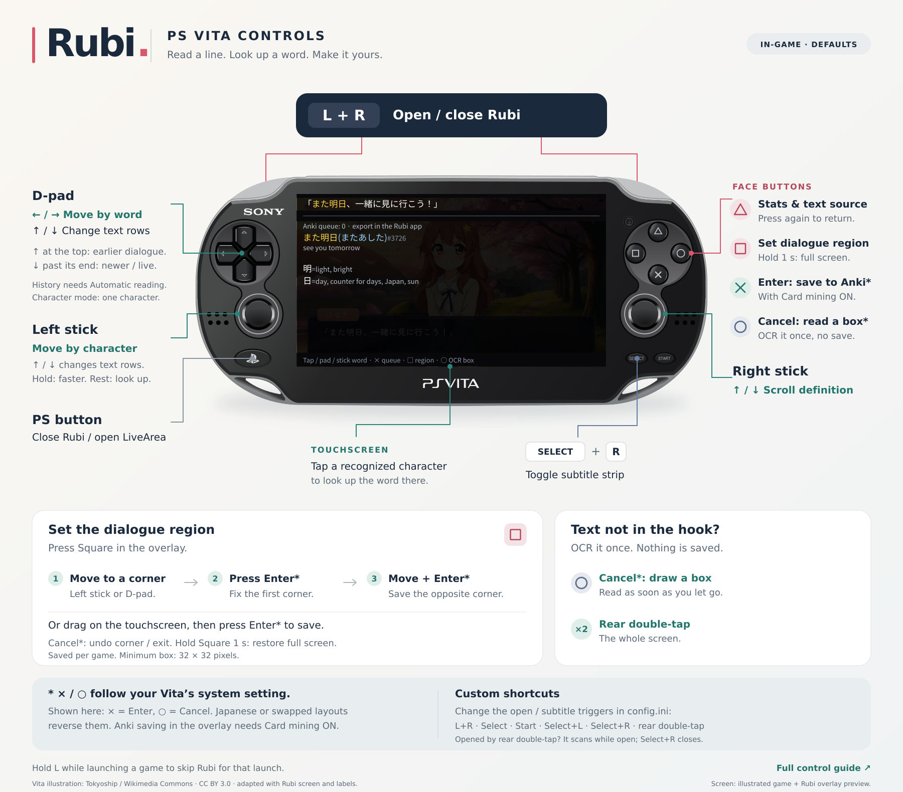
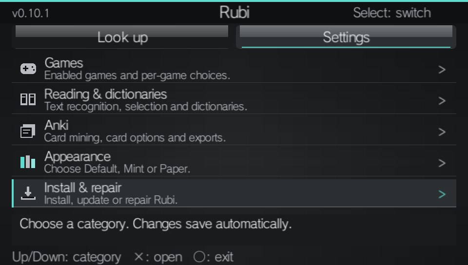
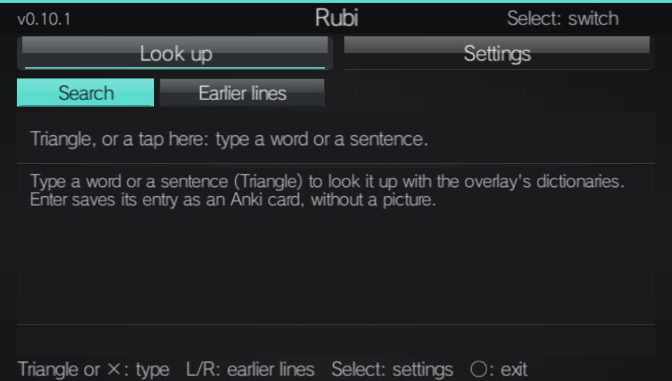
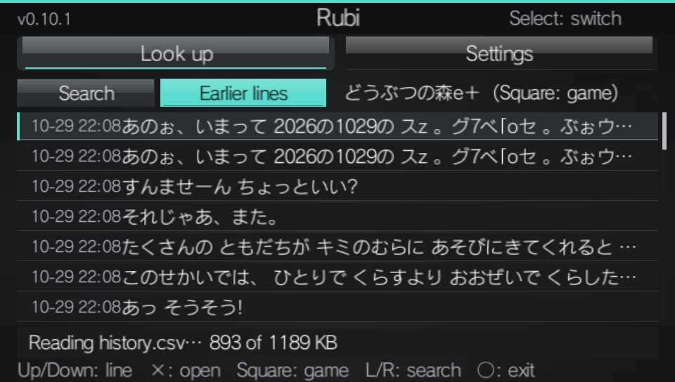
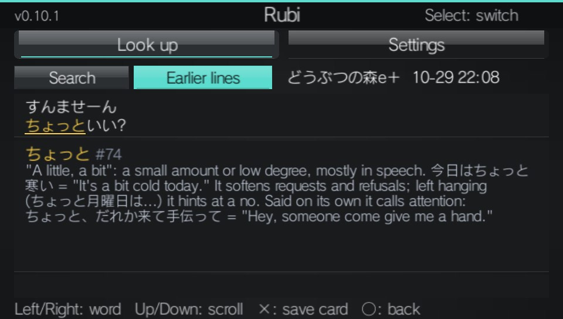
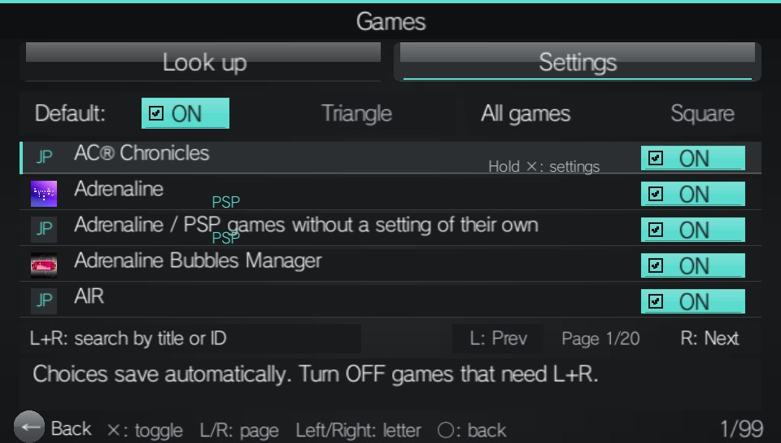
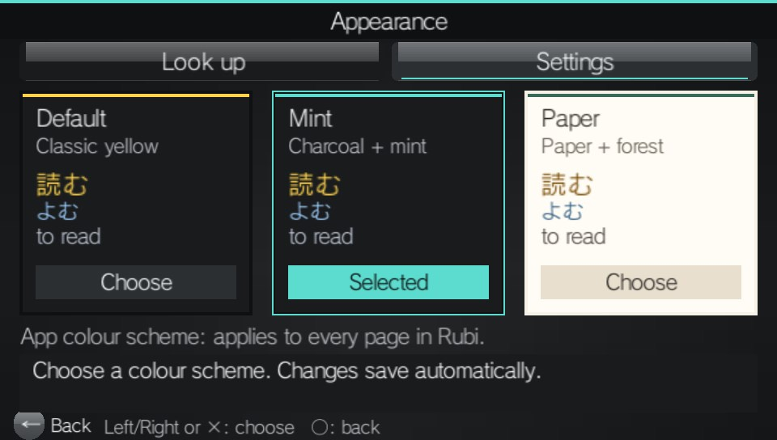

https://github.com/user-attachments/assets/f9485d78-d3a1-40c2-894f-7cd2c7d4c727

You can learn Japanese from your PS Vita :) this is real time, local OCR on the Vita

In a visual novel, press L + R: Rubi reads the dialogue off the screen, and you pick a word to see what it means and save it as an Anki card with a screenshot. Fully offline, on the Vita itself.

## Installation instructions

You need a PS Vita on firmware 3.60–3.74 with HENkaku/Ensō or h-encore, VitaShell, and
**Settings > HENkaku Settings > Enable Unsafe Homebrew** turned on.

Download the [Rubi .zip](https://github.com/bee-san/Rubi_for_vita/releases/download/v0.10.5/Rubi-0.10.5.zip)
and extract it.

Install Rubi-0.10.5.vpk with VitaShell, open Rubi, choose Settings → Install & repair → Update, then restart the Vita

# Usage

Go to a game and press left trigger + right trigger to open the overlay.

PS Vita illustration by [Tokyoship](https://commons.wikimedia.org/wiki/User:Tokyoship),
[Wikimedia Commons](https://commons.wikimedia.org/wiki/File:PlayStation_Vita_illustration.svg),
[CC BY 3.0](https://creativecommons.org/licenses/by/3.0/); adapted with control labels and an illustrated
Rubi overlay over the [promo's original visual novel artwork](https://github.com/bee-san/Rubi_for_vita/blob/main/docs/promo/README.md#the-captures-capturerunsh).

1. Left trackpad == word by word lookup
2. Left joystick == character by character
3. Double tap the back of the Vita to OCR, useful for menus etc that may not appear in dialogue text
4. Text not in the hook (menu options, choices...)? Press Circle and draw a box around it. As soon as you let go, Rubi OCRs that box once and shows it in the overlay. No confirm, nothing saved: close the overlay with L + R and you're back to the dialogue
5. Mine anki cards by pressing X in the overlay
6. Press Triangle to see stats, a hook means we get the text from the game ram (most games do this). OCR means we take a photo of the screen and ask a robot to identify what the text is, this is all done on the Vita -- no internet!
7. Press Square to set a dialogue region. This increases accuracy a lot. If you have text above the dialogue box... Double tap the back to OCR it, or press Circle and box it ;)
8. Press Up on the left trackpad to read previous lines and mine from them, that way if you're ever faced with a dialogue and you kinda were whitenoising what the characters were saying you can just re-read it
9. There is a Rubi app that lets you disable the overlay for some games like Uncharted where you use both triggers (or any game you like). You can also look up words you want in your dicts and mine them
10. Also you can install custom dicts, but it's a bit of a pain... I don't want to support custom dicts bc they are unpredictable in terms of HTML / Size and the Vita is super brittle so custom dicts may break everything :/

## Screenshots

random assorted screenshots from the actual Rubi app. Big thanks to Shoui for helping me nail the Sony Vita design language

# ai usage

this project uses AI, mostly claude opus 5.5
i am a software engineer, u can look atmy github to see i have built massive systems before ai

llms are really bad at designing software for the vita, especially software that has never been achieved before like fully local OCR. i consulted with some great engineers like https://github.com/shoui520 who know a lot about how the vita is designed. They even contributed to this project with some code fixes.

ai is really good at doing gruntwork that i dont want to do. for example, "when i am in a game and i have a ocr region set but the game has a texthooker, and hooked text comes in and then i press lt + rt triangle triangle X lt + rt my vita crashes and the logs say we went over our memory allocation as we tried to allocate 3 bytes more than needed. find where those 3 bytes are" and the ai will spend like 10+ hours and write me a report that tells me where those 3 bytes came from

there was a time in my life where i would be the one to find that bug. i was never the one to feel good about squashing it, i always felt good about using the things i created. so i am thankful i no longer have to do that and I can focus entirely on making the program feel great, fast, and smooth.

additionally i feel like with a lot of ai software, people spend more time building it than using it. which means to me as a user, the software is horrible to use. this software is the opposite, i definitely use this more than i code it
