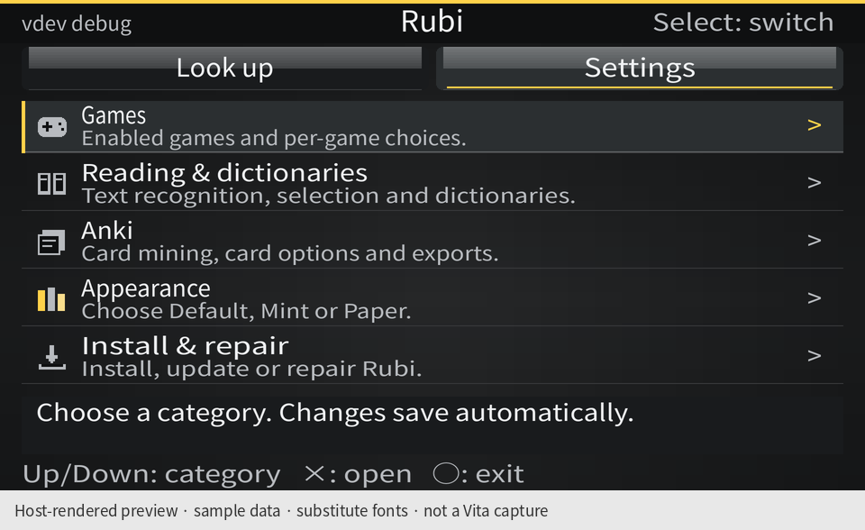
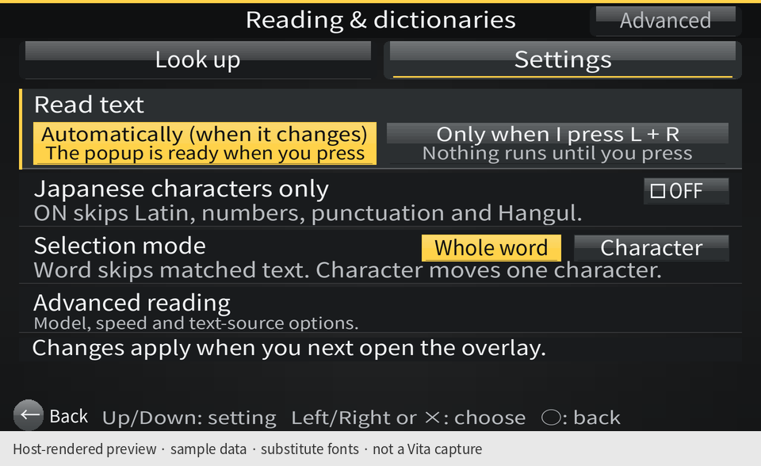

# Settings and colour schemes

**[Open the complete settings walkthrough →](WALKTHROUGH.md)** — 17 large screenshots, menu paths,
scroll positions, and a table of every setting in the app.

Rubi opens on **Settings**, with Games, Reading & dictionaries, Anki, Appearance, and Install & repair.
The top bar has only **Look up** and **Settings**. Cancel or the lower-left **Back** button goes up one level;
Select switches destinations. Technical reading options are under **Advanced reading**. Small app text is 2 px larger; the reading
headword is 28 px. Card options appear after Anki mining is enabled; **Anki actions** holds Export all.

**Settings → Appearance** offers exactly three schemes. Tap a preview card, use Left/Right, or press Enter to cycle.
Every app page changes immediately; `colour_scheme` in `app.ini` keeps the choice after closing the app.
Default preserves Rubi's yellow accent and is used for missing or unknown values. The in-game overlay and subtitle strip use the same scheme after you **restart the game**. The selection tool keeps its dark game-facing mask and warning colours.

## Sony Reader-inspired appearance

The main visual reference is **Sony Reader for PlayStation Vita (PCSC80012)**, as shown in the actual app captures
in [Aurora's Reader walkthrough](https://wololo.net/2019/12/22/psvita-tutorial-how-to-use-sonys-official-e-book-reader-in-english-with-your-own-books/).
Rubi follows Reader's charcoal canvas with a soft vignette, silver glossy toolbars, fine row dividers,
small category icons, and circular lower-left Back control. The five categories remain visible together;
the two named destinations keep settings easy to find.

Sony's public [Wi-Fi Settings](https://manuals.playstation.net/document/en/psvita/settings/wifi.html) and
[screen controls](https://manuals.playstation.net/document/en/psvita/basic/screens.html) guide the checkbox-style
switches and navigation. Default pairs charcoal with Rubi's yellow accent, Mint uses mint accents, and Paper is the light variant.

The chrome is drawn from original rectangle primitives in `settings/chrome.h`, shared by the app and preview
harness. No Reader executable, artwork, book content, or fonts are bundled. This is a Reader-inspired libvita2d interface; it does not add a
firmware UI framework, textures, animation, or allocation sites.

## Three colour schemes

| Default · charcoal and yellow | Mint · charcoal and mint | Paper · warm light and green |
| --- | --- | --- |
|  |  |  |
|  |  |  |
|  |  |  |

## Screenshot provenance

These are **host-rendered mock screenshots**, not physical Vita captures. Each PNG says this below the
960 × 544 app viewport. Games, reading, appearance, and navigation run the actual `settings/main.c` input/draw
loop. Anki and Install & repair run their actual page code over synthetic files, with the shared header composed
from a `main.c` capture. The Anki queue, game library, installation state, and installer version numbers are examples.

The harness supplies rectangles, text positions, colours, wrapping, alpha blending, and clipping. Its substitute font metrics
and the renderer's Noto Sans CJK JP font approximate firmware PVF; physical Vita layout and performance remain
unverified. The app itself continues to use the firmware PVF font.

## Recreate the previews

Build the host UI harnesses, then use Pillow and a Japanese OpenType font (the committed previews use
NotoSansCJKjp-Regular.otf, distributed under the SIL Open Font License). The font is not bundled with the app.

```sh
cmake -S . -B build/host -G Ninja -DVJO_WITH_VOCR=OFF
cmake --build build/host --target vjo-settings-app-tests vjo-settings-games-tests vjo-settings-anki-tests vjo-settings-install-tests
python3 tools/render_theme_previews.py --walkthrough --font /path/to/NotoSansCJKjp-Regular.otf
```

The renderer runs `settings_navigation`, `app_colour_schemes`, and each harness's `settings_walkthrough` fixture.
The first two check controller/touch choices, persistence, failed saves, unreadable files, backup recovery, and
independence from an unreadable `config.ini`. The optional walkthrough fixtures only run when a preview output
directory is supplied. Omit `--walkthrough` to regenerate only the colour gallery and Advanced reading preview.
