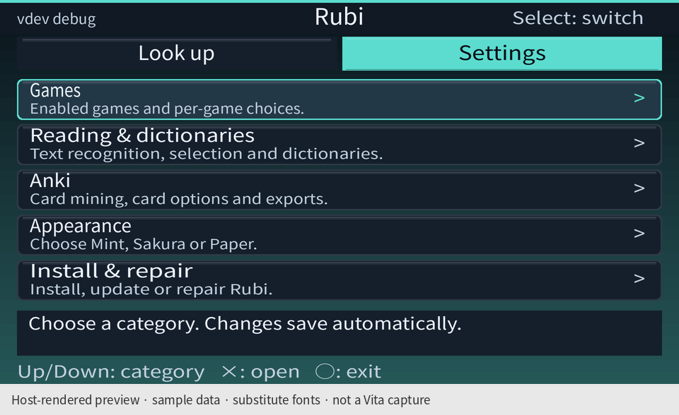
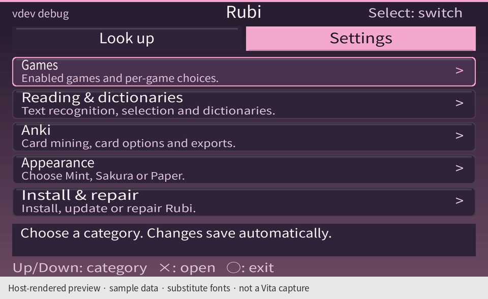
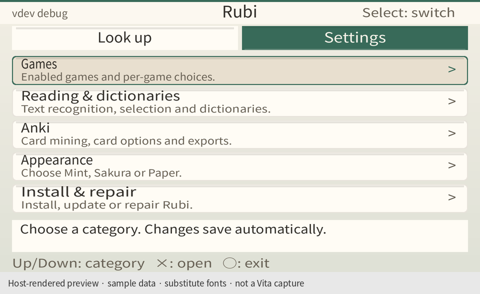
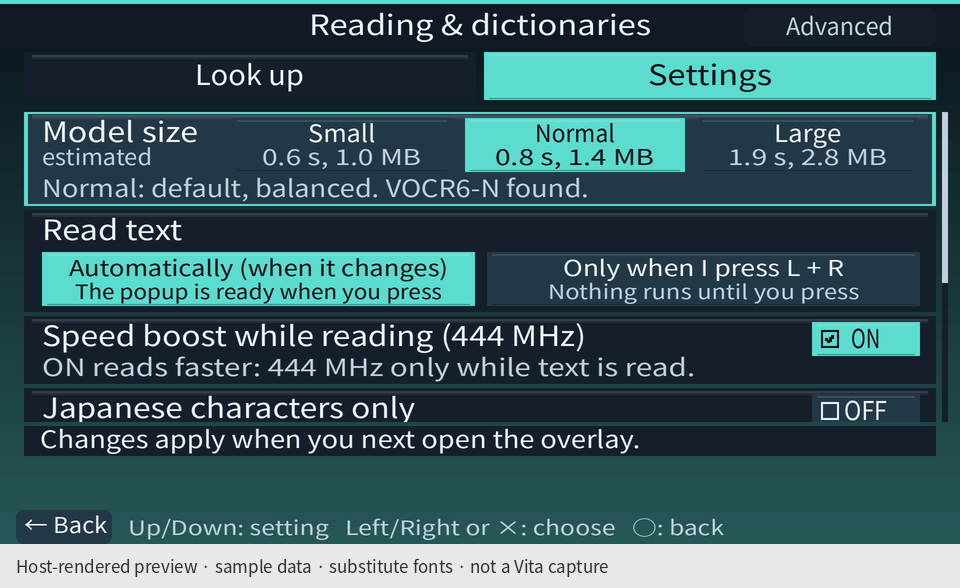
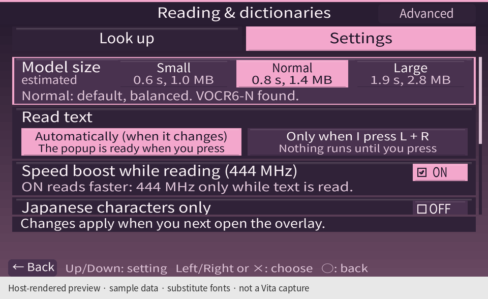
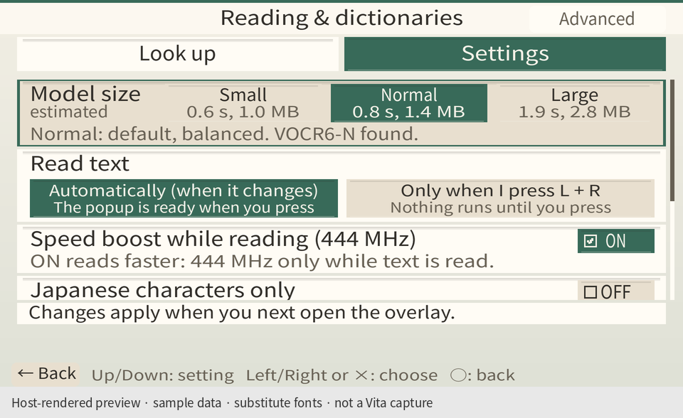
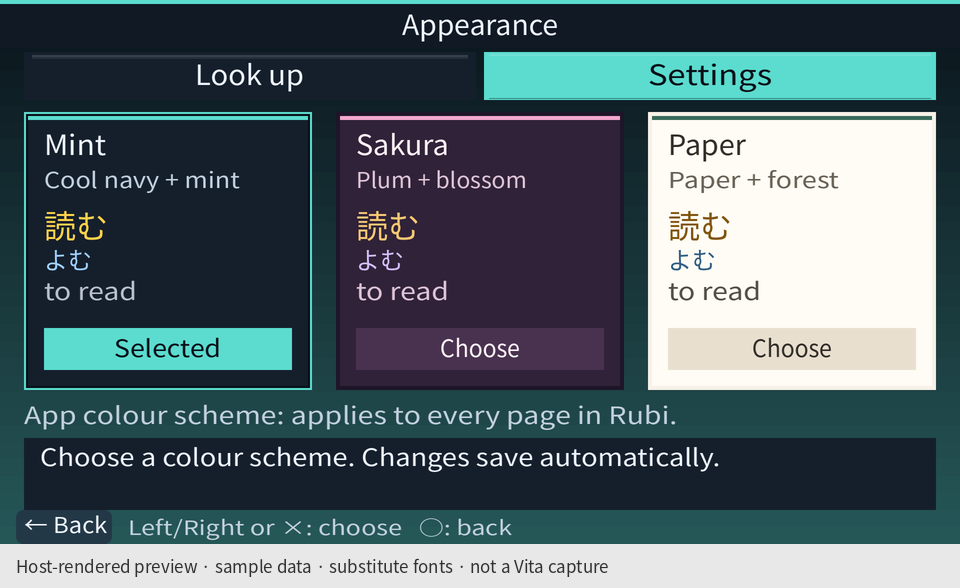
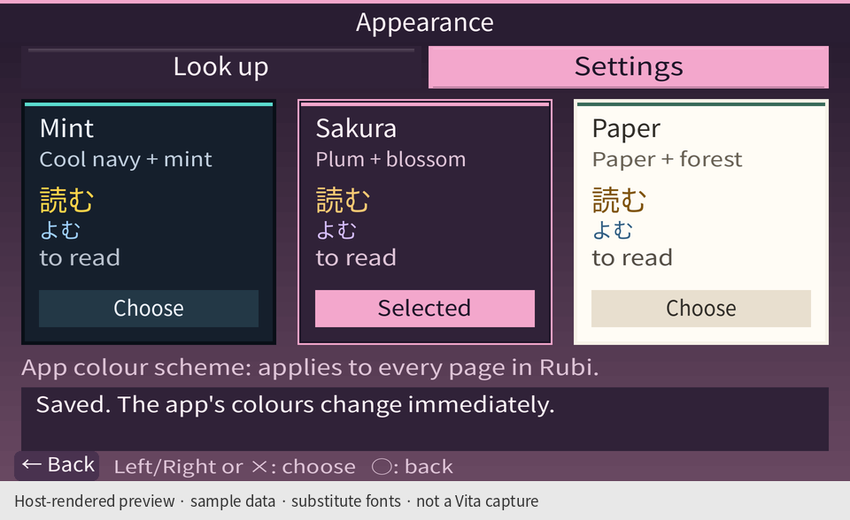
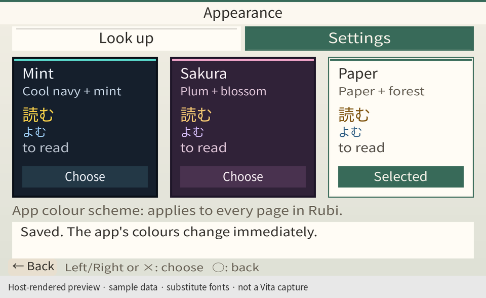

# Settings and colour schemes

**[Open the complete settings walkthrough →](WALKTHROUGH.md)** — 15 large screenshots, menu paths,
scroll positions, and a table of every setting in the app.

Rubi opens on **Settings**, with Games, Reading & dictionaries, Anki, Appearance, and Install & repair.
The top bar has only **Look up** and **Settings**. Cancel or the lower-left **Back** button goes up one level;
Select switches destinations. Technical reading options are under **Advanced reading**.

**Settings → Appearance** offers exactly three schemes. Tap a preview card, use Left/Right, or press Enter to cycle.
Every app page changes immediately; `colour_scheme` in `app.ini` keeps the choice after closing the app.
Mint is the default for existing installations and unknown values. The in-game overlay keeps its existing colours.

## Vita-inspired appearance

The visual references are Sony's public PS Vita user guide: [Wi-Fi Settings](https://manuals.playstation.net/document/en/psvita/settings/wifi.html)
and [Using the screens](https://manuals.playstation.net/document/en/psvita/basic/screens.html).
The app follows their tinted backgrounds, centered page titles, rounded menu surfaces, glossy controls,
checkbox-style switches, and lower-left Back control. The five categories remain visible together on one screen.

The chrome is drawn from original rectangle primitives in `settings/chrome.h`, shared by the app and preview
harness. No Sony artwork or fonts are bundled. This is a Vita-inspired libvita2d interface; it does not add a
firmware UI framework, textures, animation, or allocation sites.

## Three colour schemes

| Mint · navy and mint | Sakura · plum and pink | Paper · warm light and green |
| --- | --- | --- |
|  |  |  |
|  |  |  |
|  |  |  |

## Screenshot provenance

These are **host-rendered mock screenshots**, not physical Vita captures. Each PNG says this below the
960 × 544 app viewport. Games, reading, appearance, and navigation run the actual `settings/main.c` input/draw
loop. Anki and Install & repair run their actual page code over synthetic files, with the shared header composed
from a `main.c` capture. The Anki queue, game library, installation state, and installer version numbers are examples.

The harness supplies rectangles, text positions, colours, wrapping, and clipping. Its substitute font metrics
and the renderer's Noto Sans CJK JP font approximate firmware PVF; physical Vita layout and performance remain
unverified. The app itself continues to use the firmware PVF font.

## Recreate the previews

Build the host UI harnesses, then use Pillow and a Japanese OpenType font (the committed previews use
NotoSansCJKjp-Regular.otf, distributed under the SIL Open Font License). The font is not bundled with the app.

```sh
cmake -S . -B build/host -G Ninja -DVJO_WITH_VOCR=OFF
cmake --build build/host --target vjo-settings-app-tests vjo-settings-games-tests vjo-settings-anki-tests vjo-settings-install-tests
python3 tools/render_theme_previews.py --walkthrough --font /path/to/NotoSansCJKjp-Regular.otf
```

The renderer runs `settings_navigation`, `app_colour_schemes`, and each harness's `settings_walkthrough` fixture.
The first two check controller/touch choices, persistence, failed saves, unreadable files, backup recovery, and
independence from an unreadable `config.ini`. The optional walkthrough fixtures only run when a preview output
directory is supplied. Omit `--walkthrough` to regenerate only the colour gallery and Advanced reading preview.
