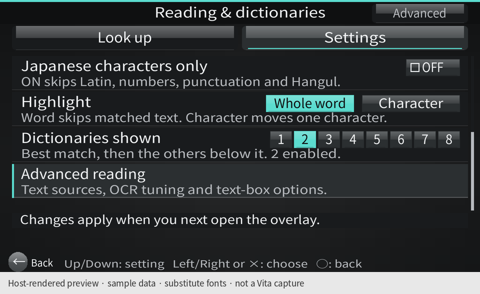
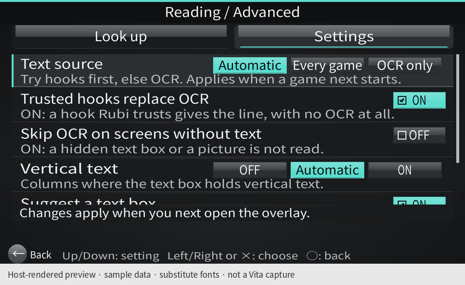
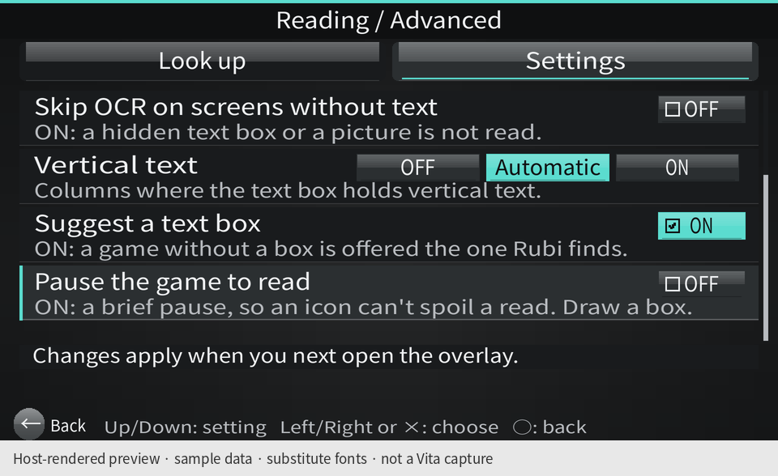
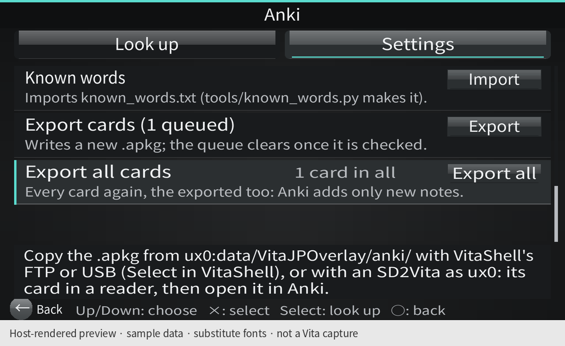

# Where all the settings live

Rubi opens here. Everything configurable in the app is inside **Settings**; **Look up** is the other destination.
Choose a category with Up/Down and Enter, or touch its row. **Select** switches between Look up and Settings.
The appearance follows Sony Reader's glossy toolbar, quiet background, and divided lists, with category icons
and an accent on the focused row.

Inside a category, **Cancel** or the lower-left **Back** button goes up one level. In Reading and Anki,
use Up/Down or the left stick to reach the rows below the screen; the thin bar on the right shows the scroll
position. A partly visible row also shows that more options follow. Touching a partly visible row first brings
it into view. Left/Right changes the selected setting; Enter toggles or cycles it.

All 15 pictures in this guide are **host-rendered previews with sample data and substitute fonts**, not captures from
a physical Vita. The installation examples use test fixture versions, including `0.8.0 debug` and `0.8.1`.
See [how the previews are made](README.md#screenshot-provenance).

## Find a setting

| Menu path | Settings and actions |
| --- | --- |
| **Settings → Games** | Default ON/OFF for games; each game's ON/OFF; search and All/ON/OFF list filters |
| **Settings → Games → hold Enter on a game** | That game's ON/OFF; Line finder: Default, Spotter, Off, On, Junk, All |
| **Settings → Reading & dictionaries** | Model size; Read text; Speed boost while reading (444 MHz); Japanese characters only; Highlight; Dictionaries shown |
| **Settings → Reading & dictionaries → Advanced** | Text source; Trusted hooks replace OCR; Skip OCR on screens without text; Vertical text; Suggest a text box; Pause the game to read |
| **Settings → Anki** | Card mining; Screenshots; Trim black bars; Card type; Game tag; Sentence readings; Duplicates; Known words import; Export cards; Export all cards |
| **Settings → Appearance** | Mint, Sakura, Paper |
| **Settings → Install & repair** | Install, Update, Check & repair, Uninstall; available actions depend on the installation state |

This table covers the app's controls. Additional technical options documented in the [configuration guide](../guide.md#settings-and-dictionaries)
are still edited in the configuration files.

## Games: enable Rubi and choose a line finder

**Path: Settings → Games.** The top row contains the default policy, search, and list filters. Each game has
its own ON/OFF switch. Enter toggles the selected game; the control hints explain the shortcuts.

**Path: Settings → Games → hold Enter on a game.** This opens its own page. The Line finder choices belong
to that game; Back returns to the list, then Back again returns to Settings. The Adrenaline row also has a
shared policy for PSP games.

## Reading & dictionaries: everyday controls

**Path: Settings → Reading & dictionaries.** At the top are Model size, Read text, and Speed boost while
reading (444 MHz). A fourth card begins at the bottom, indicating that the page scrolls.

**Same page, scrolled down.** Japanese characters only, Highlight, and Dictionaries shown are followed by
the **Advanced reading** entry. Advanced can also be opened using the button at the upper right.

## Advanced reading: text sources and OCR tuning

**Path: Settings → Reading & dictionaries → Advanced.** The first rows are Text source, Trusted hooks
replace OCR, and Skip OCR on screens without text. Vertical text starts below them.

**Same page, scrolled down.** Vertical text, Suggest a text box, and Pause the game to read are at the
bottom. Back returns to Reading & dictionaries, preserving the category hierarchy.

## Anki: mining, card options, import and export

**Path: Settings → Anki.** The first rows are Card mining, Screenshots, Trim black bars, and Card type.
The status panel reports the sample queue; it stays visible while the settings scroll above it.

**Same page, scrolled to the card options.** Card type offers Word, Sentence, Both, or Click. Below it
are Game tag, Sentence readings, and the Tag/Skip/Keep policy for Duplicates.

**Same page, scrolled to the bottom.** Known words imports the known-word list. Export cards exports the
queue; Export all cards includes cards already exported. All three actions remain in the Anki category.

## Appearance: exactly three schemes

**Path: Settings → Appearance.** Choose Mint, Sakura, or Paper by touching its card, using Left/Right,
or cycling with Enter. The choice applies immediately and is saved across launches.

See the [three-scheme comparison](README.md#three-colour-schemes) for the menu and reading page in every scheme.

## Install & repair: actions for the current state

**Path: Settings → Install & repair.** On a fresh installation, this page offers **Install** and explains
the changes it will make. The plan scrolls with Up/Down; Enter starts the selected action.

**Same path, with Rubi installed.** It now offers **Check & repair** and **Uninstall**. This is the same
page responding to the installation state.

**Same page, Uninstall selected with Right.** Selecting the action displays its plan before Enter runs it.
The example only selects the plan.

**Same path, with a newer package available inside the app.** The primary action becomes **Update**.
Version numbers here come from the synthetic installation fixture.

