# Where all the settings live

Rubi opens here. Everything configurable in the app is inside **Settings**; **Look up** is the other destination.
Choose a category with Up/Down and Enter, or touch its row. **Select** switches between Look up and Settings.
The appearance follows Sony Reader's glossy toolbar, quiet background, and divided lists, with category icons
and an accent on the focused row.

Inside a category, **Cancel** or the lower-left **Back** button goes up one level. In Reading and Anki,
use Up/Down or the left stick to reach the rows below the screen; the thin bar on the right shows the scroll
position. A partly visible row also shows that more options follow. Touching a partly visible row first brings
it into view. Left/Right changes the selected setting; Enter toggles or cycles it.

All 17 pictures in this guide are **host-rendered previews with sample data and substitute fonts**, not captures from
a physical Vita. The installation examples use test fixture versions, including `0.8.0 debug` and `0.8.1`.
See [how the previews are made](README.md#screenshot-provenance).

## Find a setting

| Menu path | Settings and actions |
| --- | --- |
| **Settings → Games** | Default ON/OFF for games; each game's ON/OFF; search and All/ON/OFF list filters |
| **Settings → Games → hold Enter on a game** | That game's ON/OFF; Line finder: Default, Spotter, Off, On, Junk, All |
| **Settings → Reading & dictionaries** | Read text; Japanese characters only; Selection mode; Advanced entry |
| **Settings → Reading & dictionaries → Advanced** | Model size; Speed boost while reading (444 MHz); Text source; Trusted hooks replace OCR; Skip OCR on screens without text; Vertical text; Suggest a text box; Pause the game to read |
| **Settings → Anki** | Card mining; Export cards; Anki actions |
| **Settings → Anki, mining ON** | Screenshots; Card type; Game tag; Sentence readings; Duplicates |
| **Settings → Anki → Anki actions** | Export all cards; known-word import is disabled pending [duplicate detection #521](https://github.com/bee-san/Rubi_for_vita/issues/521) |
| **Settings → Appearance** | Default (yellow), Mint, Paper |
| **Settings → Install & repair** | Install, Update, Check & repair, Uninstall; available actions depend on the installation state |

This table covers the app's controls. Additional technical options documented in the [configuration guide](../guide.md#settings-and-dictionaries)
are still edited in the configuration files.

## Games: enable Rubi and choose a line finder

**Path: Settings → Games.** The top row contains the default policy, search, and list filters. Each game has
its own ON/OFF switch. All games remain ON by default. [#522](https://github.com/bee-san/Rubi_for_vita/issues/522)
tracks explaining when a per-game OFF choice is useful. Enter toggles the selected game; the control hints explain the shortcuts.

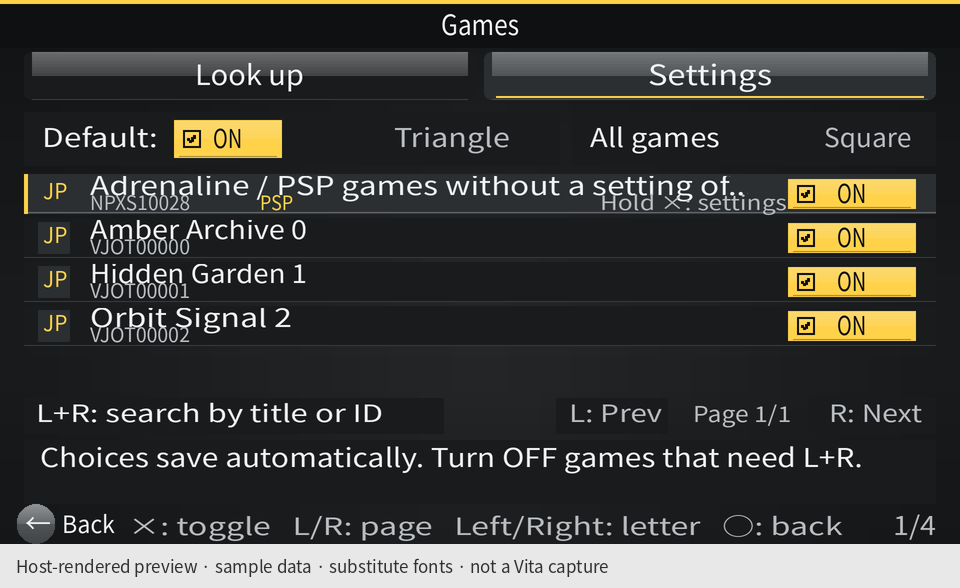

**Path: Settings → Games → hold Enter on a game.** This opens its own page. The Line finder choices belong
to that game; Back returns to the list, then Back again returns to Settings. The Adrenaline row also has a
shared policy for PSP games.

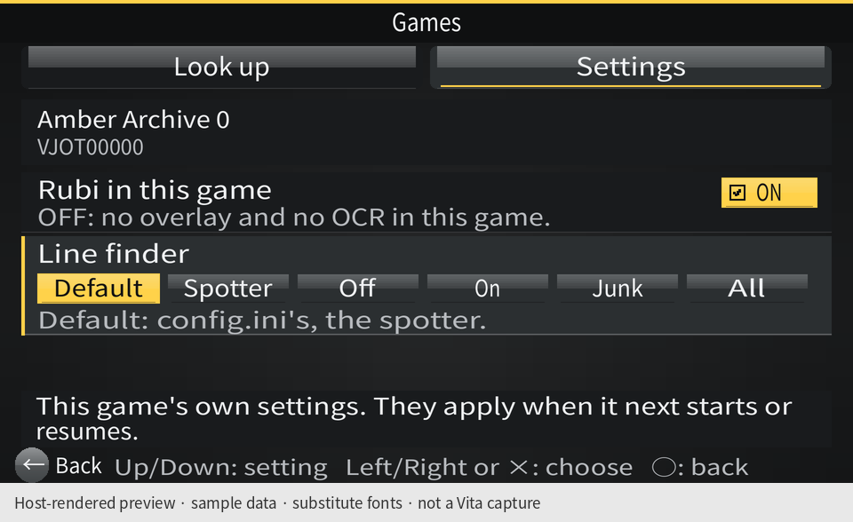

## Reading & dictionaries: everyday controls

**Path: Settings → Reading & dictionaries.** Read text, Japanese characters only, Selection mode, and the
Advanced entry fit together on one screen. Selection mode chooses **Whole word** or **Character** when looking up
text. The small app text is 2 px larger for readability.

## Advanced reading: model, speed and text sources

**Path: Settings → Reading & dictionaries → Advanced.** Model size and the 444 MHz speed boost are here,
with their existing defaults. Text source offers **Automatic** or **OCR only**; the redundant Every game choice
is removed. Old `hooks` configurations still behave as Automatic.

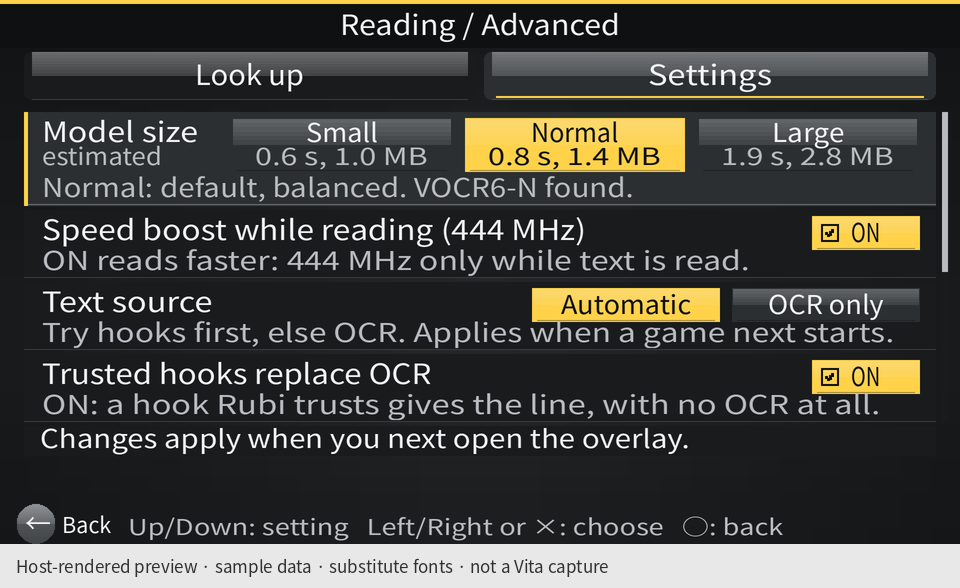

**Same page, scrolled down.** Trusted hooks replace OCR stays ON, and Skip OCR on screens without text stays OFF.

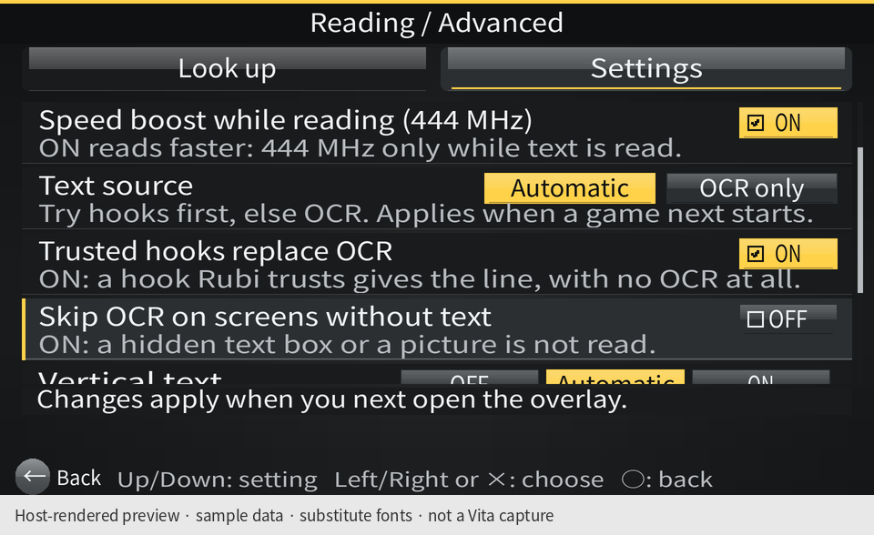

**Same page, at the bottom.** Vertical text, Suggest a text box, and Pause the game to read. Pause stays
**OFF by default** pending console testing. Back returns to Reading & dictionaries.

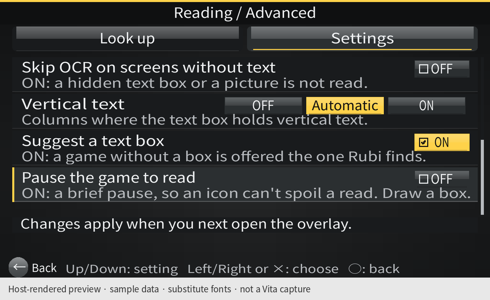

## Anki: reveal card options when mining is enabled

**Path: Settings → Anki.** With mining OFF, the page shows Card mining, Export cards, and Anki actions.
You can still export cards already saved.

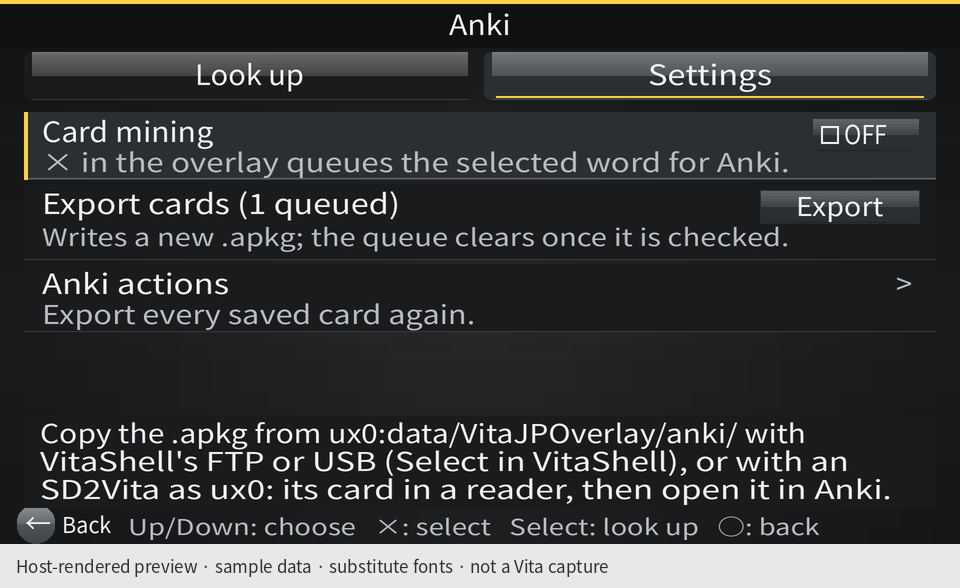

**Same path, mining ON.** Screenshots and card options appear. Black-bar trimming is automatic; it has no
separate switch. Card type offers **Word**, **Sentence**, **Both**, or **Reveal sentence**. Reveal sentence
shows the word first; tapping the card reveals its sentence. The saved `click` value stays compatible.

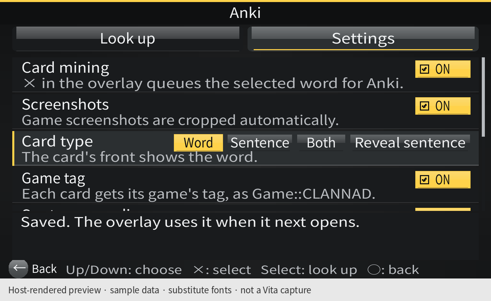

**Same page, scrolled to the remaining options.** Game tag, Sentence readings, and Duplicates keep their
existing defaults. Duplicates handles words previously mined in Rubi; it is separate from the disabled known-word import.

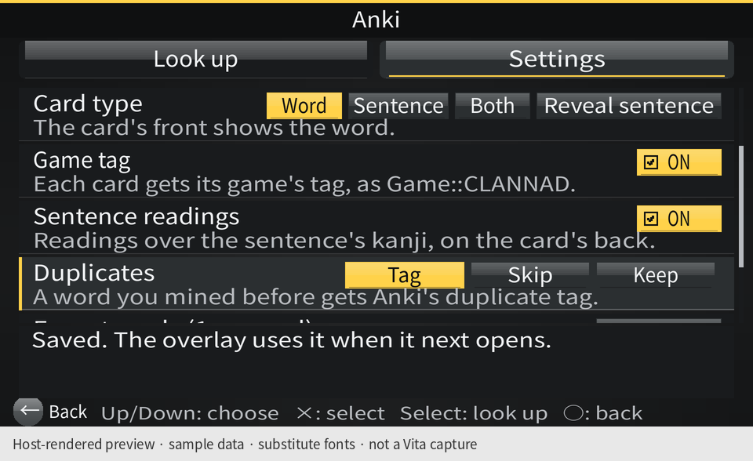

**Same page, at the bottom.** Export cards writes the queue. **Anki actions** opens the less frequent actions.

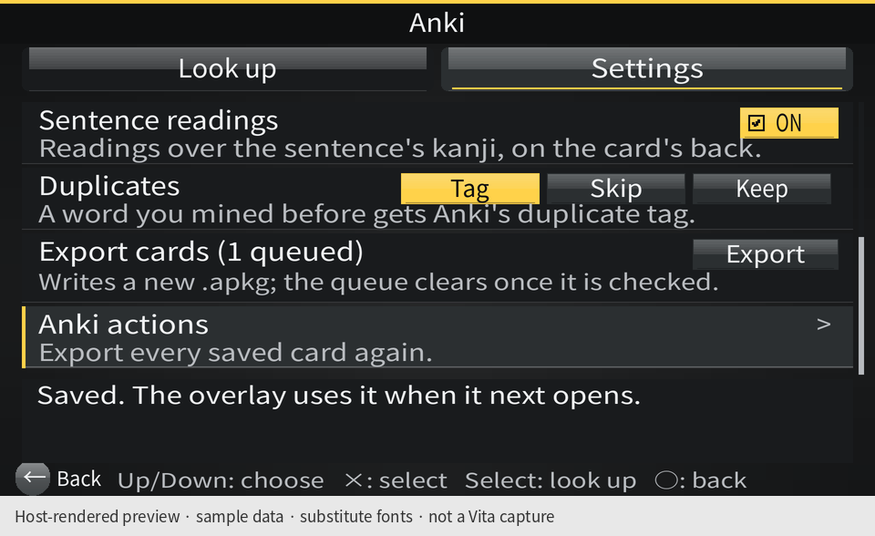

**Path: Settings → Anki → Anki actions.** Export all cards includes previously exported cards. Back returns to
Anki. Known-word import is disabled in the shipping code; its parser, index implementation, and tests remain for
[duplicate detection #521](https://github.com/bee-san/Rubi_for_vita/issues/521). An old imported index is preserved
and ignored during export.

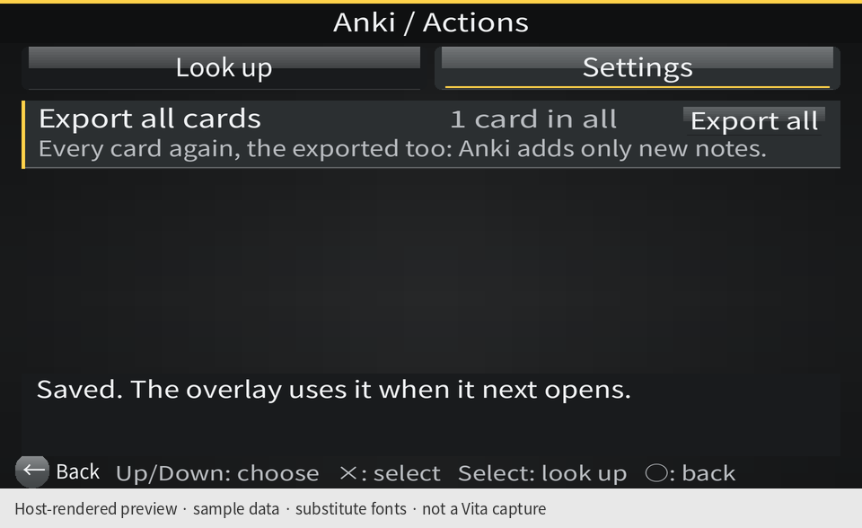

## Appearance: exactly three schemes

**Path: Settings → Appearance.** Choose **Default** (Rubi's yellow), **Mint**, or **Paper** by touching a card,
using Left/Right, or cycling with Enter. The choice applies immediately and is saved across launches.

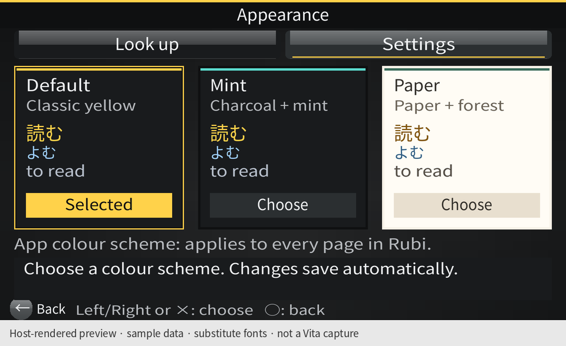

See the [three-scheme comparison](README.md#three-colour-schemes) for the menu and reading page in every scheme.

## Install & repair: actions for the current state

**Path: Settings → Install & repair.** On a fresh installation, this page offers **Install** and explains
the changes it will make. The plan scrolls with Up/Down; Enter starts the selected action.

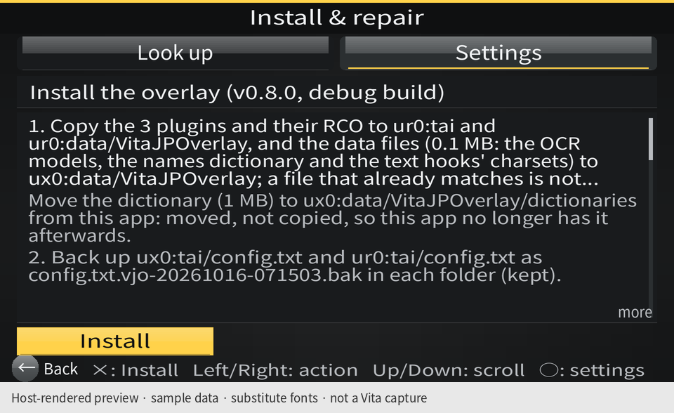

**Same path, with Rubi installed.** It now offers **Check & repair** and **Uninstall**. This is the same
page responding to the installation state.

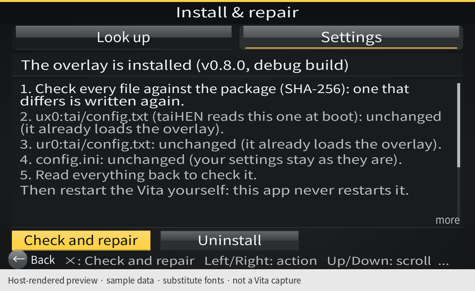

**Same page, Uninstall selected with Right.** Selecting the action displays its plan before Enter runs it.
The example only selects the plan.

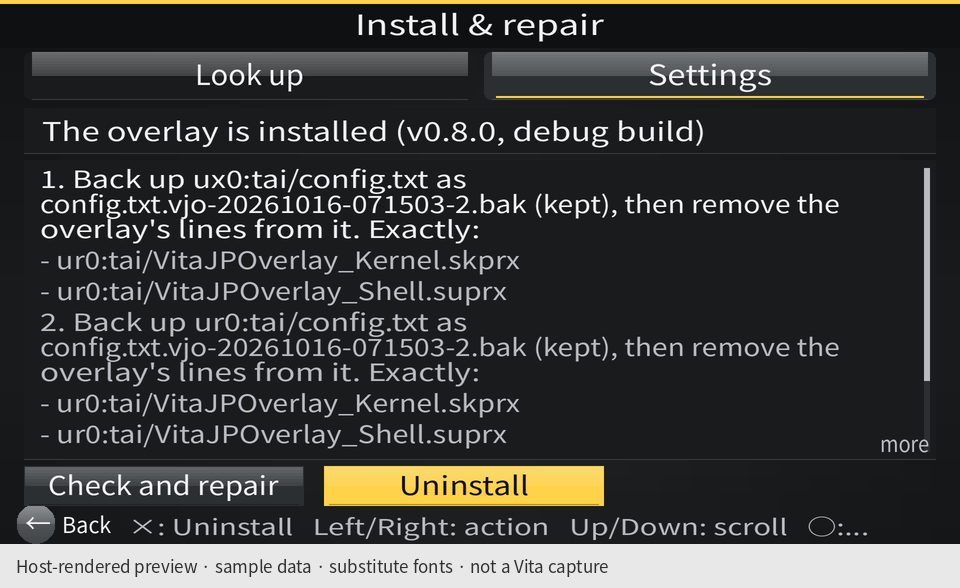

**Same path, with a newer package available inside the app.** The primary action becomes **Update**.
Version numbers here come from the synthetic installation fixture.

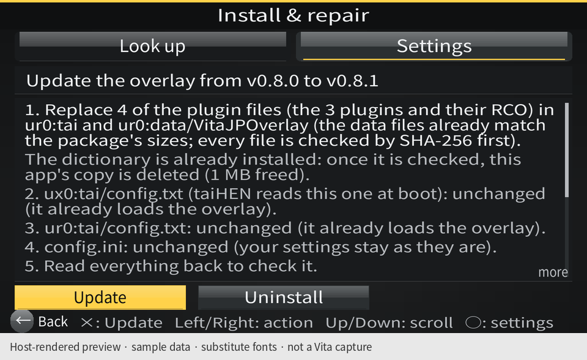
