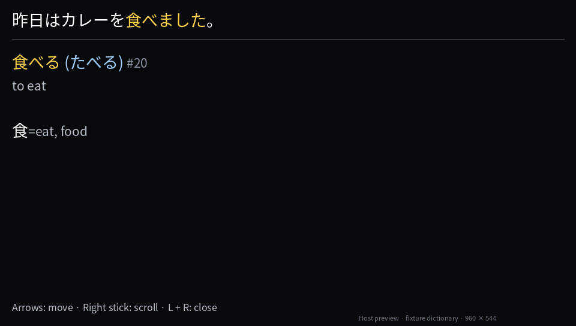
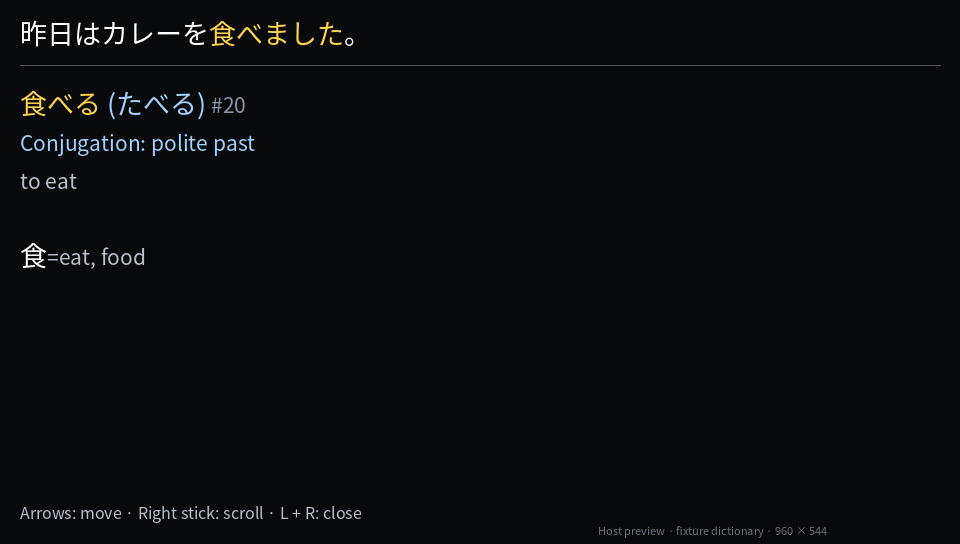
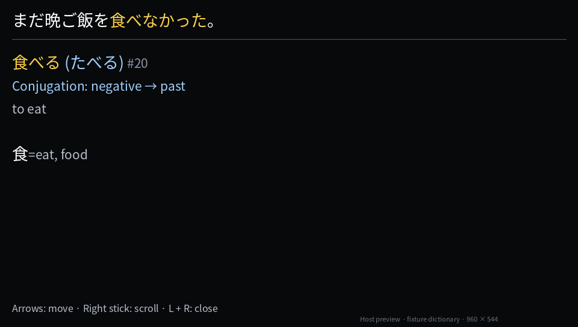
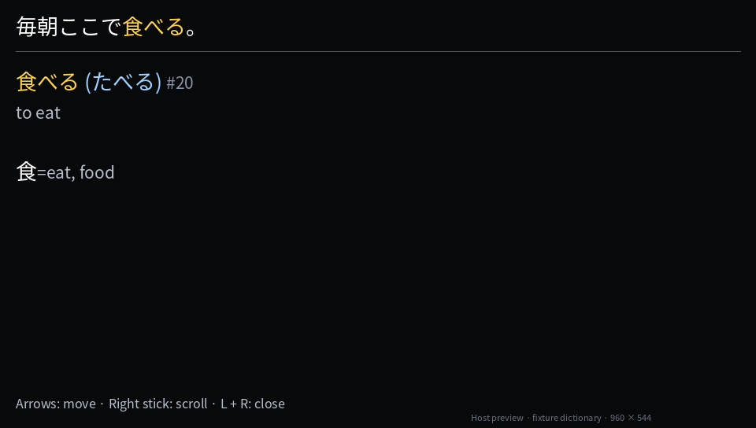

# Conjugation in dictionary entries

An inflected lookup shows its conjugation below the headword, in blue. For example,
`食べました` opens `食べる` with `Conjugation: polite past`; `食べなかった` shows
`Conjugation: negative → past`. Exact matches have no conjugation line.

The labels come from the same vendored Yomichan rules that found the entry. Reasons stay with
each occurrence, including dictionary paging and prepared/cached lookups. They do not change the
dictionary definition or the Anki card. Four reasons fit in the existing page locator; a longer
chain explicitly shows `…` before its three surface-side reasons. The dictionary format is unchanged.

These are **host-rendered previews**, drawn from the production lookup, entry builder and
`vjo_styled_header`/`vjo_styled_entry` UTF-16 text and colour/size spans. The small synthetic
dictionary uses the regression test's `食べる` fixture (rank 20 is fixture data). The baseline uses
main `ae9b02d`; the after images use this change. They use Noto Sans CJK JP at the overlay's 960×544
geometry. They do not verify the Vita's PAF font, wrapping or boot behaviour.

Before:

After:

Chained form:

Exact form:

The `local_cursor` host suite exercises formats 1–3, exact forms, irregular verbs, adjectives,
chained/long conjugations, dictionary switching, cache reuse, fallback readings, and repeated words
whose vocabulary is shared but whose conjugation differs. The generator consistency test covers
both the rule reason IDs and display labels. Both Vita builds retain their existing module pages
([memory measurements](memory-ledger-history.md#dictionary-conjugation-display)).
