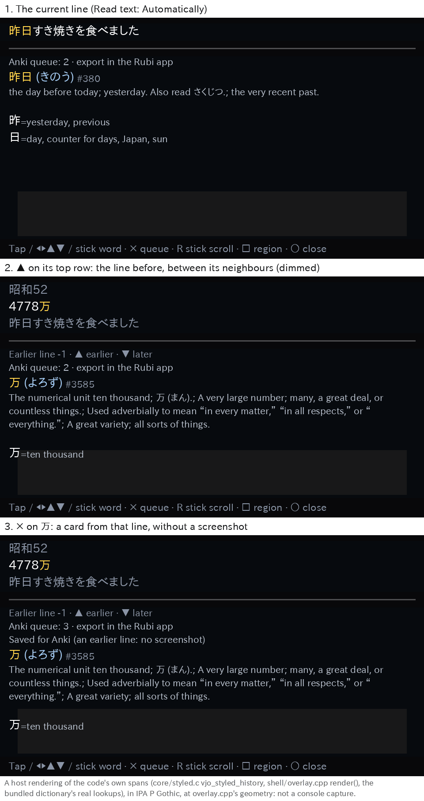

# Line history: Up walks back through this game's earlier lines

The owner, 2026-10-20 09:01Z: "Mine from history. In the overlay, you can click Up to access prior
lines. The overlay will then display 3 lines." On 昨日すき焼きを食べました, Up shows

```
昭和５２                      (dimmed)
４７７８万                    (the line in focus: the cursor and its lookup are on it)
昨日すき焼きを食べました      (dimmed)
```

"This should have per-game lines, so not every line is shown." 09:22Z: "nah, only work on
automatic": line history has the lines of **Read text: Automatically** only, the ones
`history.csv` already records ([ocr-history.md](ocr-history.md)); nothing new records a line for it.



*A host rendering of the code's own spans (the header from `core/styled.c`'s `vjo_styled_history`,
the body in `shell/overlay.cpp` `render()`'s order and strings, the bundled dictionary's real
lookups), drawn in IPA P Gothic at the overlay's geometry: not a console capture. The game worker's
normalisation stores full-width digits as ASCII (４７７８ → 4778), as `history.csv` keeps them.*

## What it does

| Key, in the overlay | Action |
| --- | --- |
| Up, on the text's top row (no row above to go to) | Show this game's line before the one shown. The first Up opens a *visit*: the current text waits, and the earlier line takes its place |
| Up, on an earlier line's top row | The line before that one, up to 32 lines back |
| Down, on an earlier line's last row | The line after it; after the newest earlier line, the current text again, with its cursor where it was |

- The focused line is shown in white between the **last row of the line before it** and the **first
  row of the line after it** (at first, the current text), both dimmed (`VJO_RGB_RANK`, the colour of
  the frequency badge), with no characters of theirs selectable. The header grows to at most five
  rows for it, and the definition below shrinks by as much (`HEADER_MAX_LINES_HISTORY`).
- The body's first line says where the text is: `Earlier line -2 · ▲ earlier · ▼ later`.
- On the focused line everything works as on the current text: Left/Right, Up/Down between its own
  rows, the left stick, a tap, the dictionaries' pages (L/R) and Enter. Each line's first word is
  looked up when it is shown, as the current text's is when the overlay opens. The arrows' Up/Down
  between lines are the d-pad's only: a held left stick stops at the text's first and last rows, as it
  stops at a one-row text's ends ([touch-lookup.md](touch-lookup.md#the-left-stick-138)).
- Only this game's lines: a record whose first column (`uuid`, `vita-PCSG00415` or `psp-<disc ID>`)
  is the running game's, as `net_job` writes it from the game Anki's cards name. Another game's lines
  between two of this game's are skipped. Consecutive identical lines are shown once (history.csv
  already collapses rescans of one screen; a line that is the same as the line after it, once filtered,
  is skipped too), and a line again after a different one (A, B, A) stays.
- A line is shown as the overlay shows a text: its rows without Japanese left out when
  `non_japanese_filter = lines` (the default), trimmed. A line with nothing left is skipped.
- **Read text: Only when I press L + R**: Up on the top row does what it did before line history,
  nothing (owner 09:22Z: "only work on automatic"); that mode records no line. Up does nothing either
  when there is no earlier line: no `history.csv` yet, none of this game's lines in its last 24 KiB,
  past the 32nd line, or no Paf memory for a visit (the log says which, in the debug build).
- A step goes to its line once no job reads the overlay's text: a lookup or a refresh of the line it
  leaves is dropped (a refresh is asked again once the current text is back), a word's preparation
  ends first. Another Up or Down pressed while a step waits for that is dropped (press again).
- Closing the overlay on an earlier line ends the visit: the current text comes back (once no
  lookup of the earlier line runs), so a reopen on the same screen shows its saved word. A game exit,
  a new region or another OCR pipeline ends it with the text, as they retire any shown text.

## Cards from an earlier line

Enter on an earlier line saves a card as on the current text, with **that line as the sentence** (it
is the overlay's text then), its word, every dictionary's entry for it, the game and the time. It has
**no screenshot**: Rubi keeps no frame of a line, and a screenshot taken now would be of another
screen (whatever the game shows now), so none is asked for. The status line says so: `Saved for Anki
(an earlier line: no screenshot)` when screenshots are on; with `anki_screenshot = off` it says what
any card's does. No audio either (Rubi records none).

## Where the lines come from (and why)

The task left two sources open: a bounded RAM ring of recent texts, or a bounded read of
`history.csv`'s end when Up asks for earlier lines. The owner's 09:22Z note settled the modes
(Automatically only, which is what `history.csv` records), and the evidence settles the rest:

- **The Shell's code pages were nearly full.** On main `f482c21` the normal Shell had 1,764 B of text
  room in its 90,112 B of text pages, which `tools/check_memory_ledger.py` checks exactly
  [measured: the build log's module row]. AGENTS.md rule 1: its permanent footprint may only shrink.
- **A RAM ring is permanent SceShell memory.** 32 lines kept for the moment Up is pressed would hold
  the texts in SceShell's `.bss` (or a permanent Paf block) for the whole session, beside a game; the
  data pages had 448 B of room. A ring also loses its lines at every Shell restart, and holds texts
  that are already on the memory card.
- **`history.csv` already has them**, with the game in its first column, written by VjoNet after each
  Automatically read (and a text source that appends its lines through `vjo_history_append`, as text
  hooks should, shows up in line history with no change). Reading them back costs nothing until Up is
  pressed past the top row.

So: when a visit opens, the control thread reads the **last 24,512 B of `history.csv`** (one read,
with the byte before them, into its existing 24 KiB static scratch, released before the call
returns), finds this game's records newest first, and keeps up to **32** of their lines in one Paf
block of **16 KiB**, held only while the visit lasts. A typical CSV record is 300-1,000 B (41 columns
of figures beside the text) [estimate from the host tests' records], so the window reaches back about
25-80 records of all games [estimate]. Nothing is read or kept at any other time; the file is never
written by this code.

- The read is on VjoControl, never on the Paf thread, so the overlay keeps drawing. It is one open,
  one seek, one read of at most 24,513 B and one close. Console time unmeasured; from
  [performance.md](performance.md)'s figures (15.3 ms per open/seek/read/close of small files) it
  should be tens of ms [estimate]. Steps within a visit read nothing.
- An append in progress on VjoNet (it appends after publishing each Automatically result) can only
  make the file's last record incomplete: a record is read only once its line's field is closed and
  the comma after it is there, so a cut record is skipped, and an append rolled back meanwhile only
  shortens the read.
- The record parser matches `history.csv`'s own quoting (`shell/history.c`: the first four fields
  quoted, `"` doubled): a record starts at a `"` after a newline whose next byte is neither `"` nor
  `,`, which no byte inside a quoted field can be.
- The visit opens when Up is pressed, even while a lookup or a refresh runs (they only read the
  overlay's text, which only the control thread writes). A refresh dropped then may already have
  appended the screen's newer line: records newer than the current text's newest record are not
  earlier lines, so that line is not shown as one (an older record of the same text still is).
- Within a visit no refresh runs (the shown line is not the screen's); a settled screen is
  recognized once the current text is back (the refresh waits, `refresh_pending`).

## Memory and pages

Every figure from the build log's module rows and ledger, both builds, main `f482c21` (the same modules as
`44d4e8d`, this work's first base) and this change,
VitaSDK gcc 15.2.0 in `vitasdk/vitasdk:2026.08` [measured]:

| | main `f482c21` | this change | room left |
|---|---:|---:|---:|
| normal Shell, text | 88,348 B | 89,980 B (+1,632) | 132 B of 90,112 |
| normal Shell, data/bss | 73,280 B | 73,520 B (+240) | 208 B of 73,728 |
| debug Shell, text | 98,732 B | 100,412 B (+1,680) | 1,988 B of 102,400 |
| debug Shell, data/bss | 73,272 B | 73,512 B (+240) | 216 B of 73,728 |
| kernel / OCR worker data/bss | | +8 B each | `VjoLedger`'s eleventh item |

The pages stay 163,840 B (normal, exact) and 176,128 B (debug); the kernel and the worker keep theirs.
The normal Shell's text pays for line history's code with `core/textfilter.c` built `-Os` (its object
288 → 240 B) and three strings in the data segment (`VJO_DATA_TABLE`: line history's two and the
dictionary's out-of-memory message, 106 B, moved out of `.rodata`); per function in
[memory-ledger.md](memory-ledger.md#tables-in-the-data-segment).

- **Paf, `VJO_SL_PAF_HISTORY` (16,384 B)**: one block per visit, from the first Up past the top row to
  the return to the current text (or the close, the game's exit). `VJO_WORST_SHELL_PAF` adds it: the
  worst case (an Anki save from an earlier line, the overlay open, its lookup) goes from 225,280 to
  241,664 B, of the 985,088 B limit. It holds the visit's table (`HistoryVisit`, 156 B on the Vita),
  the current text (at most 4,096 B, compile-time checked) and the lines, each at its own length;
  a line that does not fit ends the list there (the lines kept are the newest, without a gap).
  Typical lines (20-60 characters of 3 B) are 60-180 B, so 32 take 2-6 KiB [estimate]. A refused
  block means no visit: Up does nothing.
- **VjoControl's stack** (16 KiB): `history_open` and `history_ask` are inlined into `ctl_main`, whose
  frame goes from 256 to 312 B (+56 B under every chain of the thread); line history's own chain is
  576 B (`ctl_main` 312, `vjo_history_load` 80, `vjo_history_scan` 64, `vjo_filter_lines` 48,
  `vjo_buf_append` 16, `buf_reserve` 40, `vjo_arena_extend_last` 16), under the thread's config load
  (`apply_config` alone is 1,352 B) [measured: `arm-vita-eabi-gcc -Os -fstack-usage` with the Vita
  build's flags, both builds the same, main `f482c21` and this change; the SDK's own calls not
  counted].
- **The overlay's text arena** (`VJO_BUDGET_PAF_UI`, 20,480 B): the header's spans go from 1 to 5
  (`VJO_HEADER_SPANS`: the text and each neighbour's row and line break), so its need goes from
  17,952 to 18,016 B (`test_ledger.c`).
- **No new thread, no `sceKernelAllocMemBlock`, nothing in the kernel or the game worker** but the
  ledger's eleventh slot (`VJO_LEDGER_MAX_ITEMS` 10 → 11: 8 B of `.bss` in each module's `VjoLedger`).

## Tests

- `host/tests/test_history_lines.c` (also on the ARM lane, `tools/arm_host_tests.sh`): the parser on
  `history.csv`'s records: this game's lines newest first, other games' and a longer title ID's
  skipped, the current text not shown again, A/B/A, quotes, commas, a textbox's rows, the filter and
  trim, a record cut by the window's start or by an append at every byte, at most 32 lines, a full
  block ending the list without a gap, the writer's longest text.
- `host/tests/test_shell_history.c`: the real writer and the real reader over real files: windows of
  a file larger than one, another game's lines in between, short reads, no file, a failed read, a file
  shorter than its size, no scratch, the writer's maximum text, a record cut by a power loss.
- `host/tests/test_shell_worker.c` (`history_*`): the real control thread: Up and Down through a
  visit with lookups and moves on each line, the oldest line, the return with the cursor and the
  screen, a reopen showing the saved word, on_press, no memory, no file, a PSP game's ID; a step
  while a lookup or a refresh runs; no refresh in a visit and the one asked for after it; a close, a
  reopen during the earlier line's lookup, a game exit and a new region; the Paf block's ledger item
  and its release (filled with a pattern when taken and freed, so a pointer kept into it shows).
- `host/tests/test_shell_anki.c`: a card from an earlier line has that line as its sentence and no
  screenshot, says so, and asks the game for none; the current line's card still has its screenshot.
- `host/tests/test_core.c` (`styled_history_header`): the header's composition and dimming: the
  neighbours' rows and colours, the text's first unit, a textbox's rows, a pathological row cut at 128
  units without splitting a surrogate pair.
- `host/tests/test_cursor_nav.c` (`up_and_down_past_an_earlier_lines_rows`): the arrows over a header
  with the dimmed rows (the layout double): Up on the text's top row and Down on an earlier line's last
  row are the line steps, Up/Down between its own rows and Left/Right stay in the text.

Not tested off the console: how the dimmed rows look on the Vita's screen, the read's time on `ux0:`,
and the Paf heap's free size during a visit. Vita3K is not evidence for any of them (AGENTS.md
rule 5).
