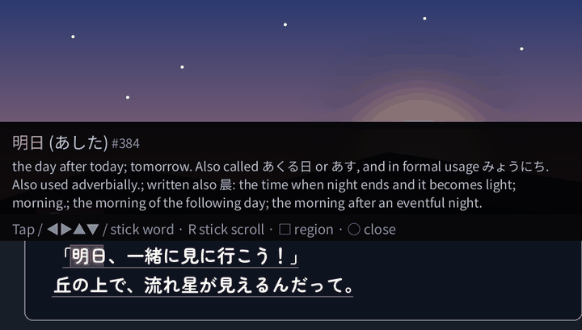
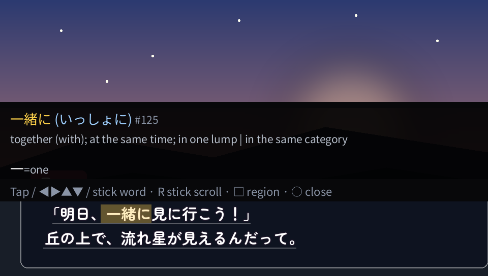
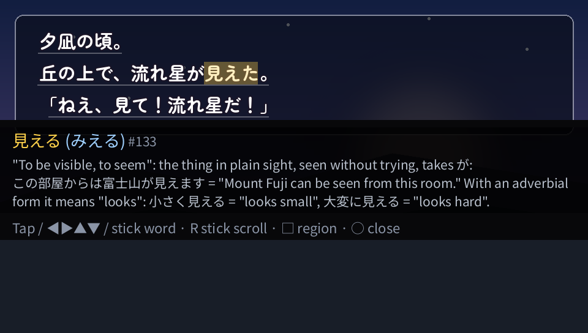
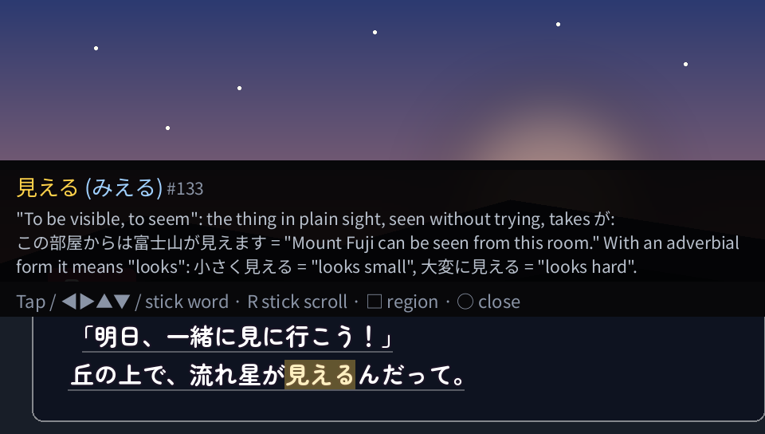
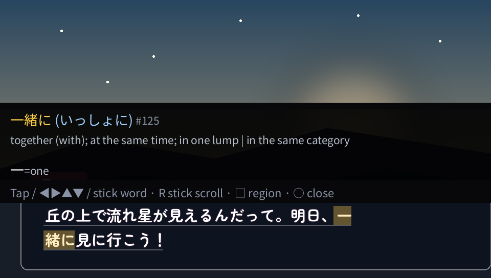

# The overlay on the game's text (API 46, #309)

An opt-in mode, off by default, in which the overlay works on the game's own text, as
[GameSentenceMiner's overlay](https://github.com/bpwhelan/GameSentenceMiner) does on a PC: the word at the cursor
is marked where the game draws it, a tap on a character looks its word up, and the dictionary popup sits beside the
text instead of covering the screen. Turn it on with **OCR & lookup → Overlay on the game's text** in the Rubi app,
or `overlay_on_text = on` in `config.ini`. **Nothing of it has run on a console yet**; the things to check there are
at the end.

  

Host renders (`tools/overlay_mock.py`): made-up frames in the repository's OFL fonts, read by the game worker's own job
built for the host and looked up in the bundled dictionary; the marks and the popup are where `shell/overlay.cpp`
puts them, the popup's text laid out by the script (paf does not run on a PC). Nothing here is a game's frame or a
console's screenshot.

| | |
|:-:|:-:|
|  |  |
| a box at the bottom: the popup above the text | text at the top: the popup below it all |
|  |  |
| Down (or a tap) on the second line | a native hook's line the game wrapped: the word marked on both rows |

## What it does

When the overlay opens on a text whose characters have places (the char map, below):

- **the word at the cursor is marked on the game's text**: a translucent rectangle on each line it spans (two at
  most). Whole word mode marks the matched word, Character mode the character;
- **the game's lines are underlined**, faintly, up to four, so that what Rubi read is visible;
- **the popup sits beside the text**: a band 196 px tall, the screen's width, below all the text when it fits
  there, else above it all, else below or above the word. It holds the dictionary entry and the hint line; the
  panel's header, which repeats the game's text, is not shown: the game's own text is the header. The right stick
  scrolls a long entry, as before;
- **a tap on the game's text** takes the character there (a tap within 12 px of a character takes the nearest
  one); a tap on the popup's band does nothing;
- **Up and Down** go to the game's line above or below, to its character nearest in x. Left, Right and the left
  stick move in reading order as before, and Up on the top line still reaches the earlier lines;
- **Enter** saves the word as an Anki card as before: the card, its sentence and its screenshot are unchanged.

It falls back to the normal full-screen popup, with nothing drawn on the game's text, whenever the text has no
places: an earlier line (line history), the region selector, the △ view, a line OCR did not read or could not
align, a text beyond the map's 16 lines and 512 characters, and a screen that no longer shows what was read (a new
scene or line: the marks go at once, and Auto mode's quiet refresh brings the new screen's text with its places).
Turning the setting on or off retires the shown text, so the next open reads the screen again.

## Where the places come from

Two sources were designed, as #309 asks; the order is hook positions, then OCR's.

- **Hook positions.** A hook in the game's layout or draw code gives each glyph's rectangle exactly. That is what
  the Vita video in #309 shows (its project is not named in the video or the issue, and I could not find it), what
  GameSentenceMiner's built-in STEINS;GATE hook does on a PC (the MAGES layout routine's per-glyph arrays: one
  engine, one build, reverse engineered), and what the hooked corpus's `cell_boxes` are (the PPSSPP and Vita3K
  capture builds' glyph quads). **Rubi's hooks give no positions today:** they read the text where the game copies
  it or keeps its page ([native-hooks.md](native-hooks.md)), not where it draws it. The char map (below) is the
  interface such a hook would fill; a per-engine layout hook is follow-up work, one engine at a time, and needs a
  console or emulator run to verify.
- **OCR's places (this change).** The game worker already runs the line finder and the recognizer. For every
  character the recognizer emits, vita-vn-ocr's `runtime/vocr_charbox.c` (#114) takes the CTC frame it fires at,
  maps it through the line's resize with the model's calibration, and cuts the line between neighbouring characters'
  centres. The shown text (OCR's after the LM and normalisation, or a native hook's) is aligned to those characters,
  so a hook's text gets OCR's places too: a hook answers, OCR places.

**Measured** on the hooked corpus's held-out pages (vita-vn-ocr's vocr6-ingest `pagepool/v1`, split `hval`: 2,097
dialogue regions; the 43,294 characters of their lines that carry renderer glyph cells, from 29 Vita and 11 PSP
titles; PSP pages read 2x, as Adrenaline shows them), with `tools/charmap_eval.py`: the game worker's own job built for the host (`vjo-ocr
--chars`: GRAD + refinement on PSP pages, VOCR5-N with the 1000k LM and VOCR5-L's cascade, the defaults), each
character's place against its glyph cell. A **hit** is a tap at the glyph's middle that selects that character
(`vjo_cmap_hit`, its 12 px slack included); the interval resamples titles (95%).

| Places | Hit | [95% CI] | Place's centre on its glyph | Characters placed |
|---|---:|---:|---:|---:|
| **OCR's cells, OCR's text** (this change) | **97.3%** | 95.7-98.4% | 95.6% | 97.7% |
| **OCR's cells, a hook's text** without line breaks (this change) | **97.3%** | 95.7-98.4% | 95.6% | 97.6% |
| OCR's cells, a hook's text with line breaks | 97.2% | 95.5-98.3% | 95.5% | 97.5% |
| OCR's line box cut by glyph widths (GameSentenceMiner's split of a word box) | 81.6% | 77.9-84.9% | 83.6% | 98.2% |
| a hook's text on the finder's line box, cut by glyph widths | 81.2% | 77.5-84.2% | 83.4% | 99.3% |
| a hook's text on its line's true extent, cut by glyph widths | 89.0% | 86.3-91.5% | 87.9% | 100% |
| the renderer's glyph cells (a layout or draw hook) | 100%, the reference | | | |

- Vita pages 97.5%, PSP pages 97.0%; 34 of the 40 titles at 95% or more, the lowest 84.0% (PCSG00753) and 84.7%
  (ULJM05674), whose misses are characters with no place (a line OCR misread, so it is not aligned). A character
  that has a place is the right one for 99.6% of taps.
- Without the four titles that share a release with a protected set (PCSG00007, PCSG00854, PCSG00866, ULJM05383):
  97.2%. VOCR5's fine-tune pools hold lines of 38 of the 49 corpus titles' VNs (vita-vn-ocr `docs/vocr6-data.md`):
  these are held-out pages, not unseen games.
- The cut of a box by glyph widths misses because it assumes a pitch: a game's half-width punctuation, kerning and
  the box's padding shift every character after them. The CTC frames place each character where the model saw it.

The text's own places in the corpus need no OCR, so a game whose hook gives positions would get 100% of them; until
one does, OCR's places are within a few points of it for the taps that matter.

## How the places are made

**In the game worker** (the game's process, never SceShell), only in a job whose request carries
`VJO_GAME_OCR_S_CHARS` (bit 25 of `speed`; the Shell sets it in the user's jobs with `overlay_on_text = on`):

1. The job's characters (`VjoVocrChars`, 4,368 B) are at the end of its workspace block, its own memory, freed
   with it. Every recognized line's greedy characters get their cells (`vocr_charbox_find` without INK, with the
   model's calibration, vita-vn-ocr `eval/charboxes_cal.json`; with the LM, the top-K's top-1 before the counter
   re-decode edits it). Such a job reads its lines without the line cache, whose entries keep no places.
2. A stream that would answer without recognition (a Luna site, a locked hook) still answers, but the job
   recognizes too: OCR's characters are where its text is placed. Without memory for OCR it answers without places.
3. After the hook selection, `core/charmap_build.c` reproduces the sentence the Shell shows (the line filter, then the
   trim), and matches each of its lines to a run of one to four recognized lines (a hook's line the game wrapped),
   the run whose characters align with the most of its own and at least half of them (`vocr_charbox_align`). Each
   character gets the cell of the recognized character it aligns to, on that line's rows; a character the
   recognizer did not read (an LM's or the normalisation's edit, a hook's) gets a zero-width cell at its neighbour:
   it is in the word's mark but holds no tap. The frame's pixels are mapped to the screen's as the frame is shown
   (a PSP game's 480 × 272 frame 2×, Adrenaline's 960 × 544 frame as it is).
4. The block goes after the text and its recognizer's copy in `VjoGameOcrResult.text`, whose last bytes are zero
   otherwise: no struct grows, and the result's last byte stays zero for the kernel's check.

**In the Shell** (UI only): `run_vocr` and the quiet refresh copy the block after the sentence's NUL in
`local_text` when it was made for exactly that sentence (`vjo_cmap_carry`: its length and FNV-1a), with no lookup
and no allocation; the open overlay copies it with the text into its UI block and draws from that copy.

## The block

`core/charmap.h` has the format (version 2): 16-bit little-endian words at any byte offset; a 16-byte header (`'C'
'M'`, the version, the line count, the character count, the sentence's length and FNV-1a, the space's width and
height: the screen's); 6 bytes a character (its byte offset in the sentence and its cell's x0, x1), then 8 bytes a
line (its rows, its first character and their count). At most 16 lines and 512 characters: 3,216 bytes. The reader
refuses a block that does not tile its characters in order, points outside the sentence, or runs past the buffer
(`host/tests/test_charmap.c` flips every bit of a block).

## Memory

Measured on the packaged modules of both builds, main `e2100e0` against this change (VitaSDK in the fast gate's
container; [memory-ledger](memory-ledger.md#the-overlay-on-the-games-text-api-46-309)):

- **SceShell: the module's pages are unchanged** (163,840 B normal, exact; 176,128 B debug). The overlay's copy of
  the cursor's text (4,096 B) moved from the Shell's data pages into the open page's UI block, where the char map
  follows it: a PAF allocation made when the page opens and freed when it closes (`VJO_BUDGET_PAF_UI` 20,480 →
  24,576 B). The data segment gives back the page the new code takes. No thread, stack or allocation after boot.
- **The game worker: one code page more** in each game that is ON (180,224 → 184,320 B normal, 188,416 → 192,512 B
  debug), in the game's partition: vita-vn-ocr's cell finder and aligner, the map's writer and the job's calls. Its
  data pages are unchanged. A job with the setting on takes its characters in its workspace block (one page more in
  the largest job, `VJO_BUDGET_GAME_WORKSPACE` 1,220,608 → 1,224,704 B); a job without it takes nothing.

## Cost (estimates)

Instruction counts under qemu-arm (`-one-insn-per-tb`) of `core/charmap.c` and `core/charmap_build.c` built with
`arm-linux-gnueabihf-gcc-14 -Os -mthumb -mcpu=cortex-a9`, a 3-line, 70-character text, minus a run that only sets it
up; one instruction a cycle at 333 MHz. Nothing was measured on a console.

| What | Where, when | Instructions | ≈ at 333 MHz |
|---|---|---:|---:|
| the cells of one line (`vocr_charbox_find` without INK) | the worker, per recognized line | 10-27 K (vita-vn-ocr `docs/char-boxes.md`) | ≤ 0.1 ms |
| the char map of OCR's text / of a hook's text without line breaks | the worker, once a job | 41 K / 44 K | 0.13 ms |
| carrying and checking it (`vjo_cmap_carry`, `vjo_cmap_find`) | the Shell, once a new text | 8 K | 0.02 ms |
| a tap, the word's marks, the lines' underlines and the popup's place | the Shell, a key or a tap | 3 K | 0.01 ms |

A recognized line costs about 0.3-0.5 s, so the places' own work adds well under 1% to a job. The larger costs are
the ones the setting brings with it: every job reads without the line cache (on the owner's test.4 log at least 72
of 482 lines came from it, about 15% [measured, audit-overlay-boxes]), and in a game whose hook answers without OCR
the jobs recognize again. The drawing is paf's: six planes and the panel are sized and placed on a key, a tap or a
new text, never every frame; their GPU cost beside a game is unmeasured. **Off, none of it runs:** the request
carries no bit, the worker allocates nothing for it and the Shell draws nothing.

## Reviewing it on a PC

`tools/overlay_mock.py` draws synthetic visual-novel frames (a drawn backdrop and box, text in the repository's
OFL fonts: Zen Maru Gothic, Noto Sans JP), reads them with the host build of the worker's job (`vjo-ocr --chars`)
and Rubi's lookup (`vjo-cli`), and draws the marks, underlines and popup where `shell/overlay.cpp` puts them. paf
does not run on a PC, so the popup's own text is laid out by the script. `--frame PAGE --region x0,y0,x1,y1` draws
every character's cell on a frame, for a local check; corpus and game frames stay local.

## Limits

- Horizontal text only: no places for vertical columns.
- A hook's text gets places only where OCR read the same characters (at least half of each line).
- With the setting on, a game whose hook answered without OCR reads as an OCR game does: a screen that keeps
  changing, or a block the job could not take after its memory check, ends that read as it ends OCR's, where the
  hook alone would have answered (the next read tries again).
- The cells' accuracy is the measurement's above, on the corpus's 40 titles; a game font far from them could place
  them worse, and narrow punctuation is the least exact.
- No hook gives positions yet (above): the first source in the order is the format's, for later work.
- After a visit to an earlier line longer than the current text, the current text's map is overwritten in the
  Shell's buffer (line history reuses it): its marks come back with the next refresh. The reader refuses the
  overwritten block, so nothing wrong is drawn.
- Nothing of it has run on a console: the layout, the marks' alignment on the screen and the drawing's cost are
  host-built and unchecked there.

## To test on the console

With `overlay_on_text = on` (the Rubi app: OCR & lookup, **Overlay on the game's text**):

- CLANNAD (`PCSG00415`): the marks sit on the word in the dialogue box, the lines are underlined, a tap on a
  character picks it, Up/Down move between the box's lines, the popup does not cover the text, the marks go when
  the next line appears, and Enter still saves a card;
- one PSP game in Adrenaline: the same, on a 2× picture;
- a hooked Vita game (Text source: Automatic): the same, with the hook's text;
- the game's frame pacing with the overlay open (no stutter while moving the cursor);
- logs: `log.txt`, `kernel.txt` and `tools/install_ftp.sh --collect`.
