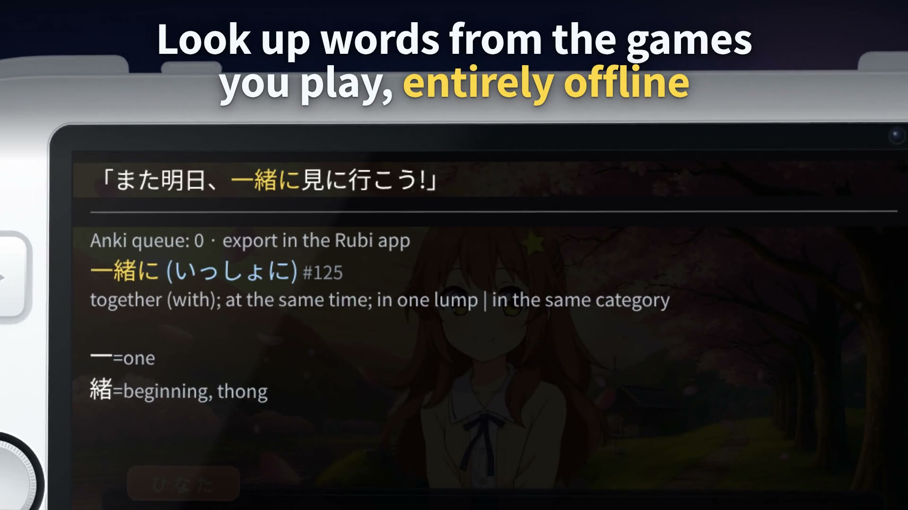

# Promo video

A 44-second promo for Vita JP Overlay, written as a [HyperFrames](https://hyperframes.heygen.com)
composition: HTML, CSS and one GSAP timeline, rendered frame by frame in headless Chrome.

[](media/promo-1920x1080.mp4)

| File | What it is |
| --- | --- |
| [`media/promo-1920x1080.mp4`](media/promo-1920x1080.mp4) | 1920 × 1080, 30 fps, H.264 and AAC, 44 s |
| [`media/promo-1080x1920.mp4`](media/promo-1080x1920.mp4) | 1080 × 1920, the vertical cut |
| [`media/poster.jpg`](media/poster.jpg), [`media/promo.gif`](media/promo.gif) | the poster frame and a short loop for READMEs |
| [`media/stills/`](media/stills/) | one still per scene |

The console's screen shows recreations of this repository's own UI:

- the overlay, from `shell/rco/vitajpoverlay.xml`, `shell/overlay.cpp` and `core/styled.h`;
- the Overlay app, from `settings/main.c` and `settings/anki_page.c`, drawn with their geometry, colours and strings;
- the app's LiveArea art, from `settings/assets/`.

The game is an original mock visual novel made for this video. No game, console or Sony artwork is
used, and the console is an original drawing with no logos.

## Re-render

You need Node.js 22 or newer, FFmpeg and FFprobe on `PATH`, and Python 3 with fontTools for the
font subsets.

```sh
cd docs/promo
npm ci                              # hyperframes 0.8.162 and gsap 3.14.2, both pinned
npx hyperframes browser ensure      # the chrome-headless-shell HyperFrames renders with
npm run build                       # src/ -> index.html (the landscape composition)
npx hyperframes lint . && npx hyperframes check .
npm run render                      # renders/promo-1920x1080.mp4 (CRF 20)
npm run render:vertical             # renders/promo-1080x1920.mp4 (builds the portrait index.html, renders, restores)
bash tools/media.sh                 # media/: the two films, the poster, the GIF and the stills
```

`npx hyperframes preview` opens the composition in HyperFrames Studio. With four workers, one cut
renders in under two minutes on this project's build host. After changing on-screen text, run
`python3 tools/fonts.py` (`pip install -r tools/requirements-fonts.txt`).

The music, the sound effects and the night sky are generated, and their outputs are committed. With
Python 3.11 or newer, `pip install -r tools/requirements-audio.txt && python3 tools/make_audio.py`
writes `assets/audio/`. With numpy 2.3.3 and FFmpeg n8.1.3 that gives the committed files byte for
byte. `python3 tools/make_stars.py` (standard library only) rewrites the generated parts of
`assets/vn/vn-bg.svg` and `vn-livearea.svg`.

| Path | What it is |
| --- | --- |
| `src/promo.template.html` | the markup of every scene and screen |
| `src/promo.css`, `src/promo.js` | the styles, and the one paused GSAP timeline |
| `src/script.mjs` | the words and the timing: captions, dialogue, the installer's output, sound cues |
| `tools/build.mjs` | builds `index.html` (`--layout landscape` or `portrait`), drawing the Overlay app's pages as SVG; `--check` fails when `index.html` is stale |
| `tools/fonts.py` | fetches the fonts at a pinned google/fonts commit, checks their SHA-256 and subsets them to the characters of the sources |
| `tools/make_audio.py` | synthesizes the music and the sound effects from code (numpy 2.3.3, then FFmpeg `loudnorm`) |
| `tools/make_stars.py` | bakes the night sky's stars and skyline into `assets/vn/vn-bg.svg` and `vn-livearea.svg` (fixed seeds) |
| `tools/media.sh` | cuts the poster, the GIF and the stills from the rendered films |

## Scenes

| # | Time | Caption | On the console |
| --- | --- | --- | --- |
| 1 | 0–4 s | Learn Japanese with your PS Vita *for free* | The mock visual novel types its line. |
| 2 | 4–9 s | Look up words from the games you play, *entirely offline* | L + R opens the overlay on キラキラ; a tap on 一緒に looks it up. |
| 3 | 9–13.5 s | Create flashcards of *words you don't know* | × queues the word; the queue goes from 2 to 3 cards. |
| 4 | 13.5–16.5 s | Export them as *Lapis* cards for Anki | The card as Anki shows it with the Lapis note type. |
| 4b | 16.5–20 s | Export cards to a dated *.apkg* file | The Overlay app's Anki page writes the file and clears the queue; import it into Anki. |
| 5 | 20–24 s | It only runs in *the games you turn on* | New text types out, settles and is read once. |
| 6 | 24–29.5 s | *Easy install*, plus a one-time setup | VitaShell's FTP server, `install-vita.sh`, the VPK in VitaShell, reboot. |
| 7 | 29.5–33.5 s | Now it's installed: go to your game and press *L + R* to look up words. | L + R opens the overlay. |
| 8 | 33.5–40.6 s | Turn it off for specific games, *so it doesn't get in the way* | ○, PS, the home screen, the Overlay app opens beside the suspended game, one game turned OFF, back to the game. |
| | 40.6–44 s | End card | Free, fully offline, open source; the project's address. |

## What the video claims

Every caption was checked against the code on `main` (e53d9fb, which has the Anki export, #125).
Where the original script said something that is not true of today's code, the video says what is
true instead. Those lines are marked **changed**.

| Scene | What it says | Why it is true |
| --- | --- | --- |
| 1 | Free | GPL-3.0; the release bundles the dictionary and the models. |
| 2 | Entirely offline; recognition and the dictionary run on the Vita | The default engine (`ocr_backend = vocr`) runs in the game's process (`game_ocr/`), and the bundled `plaintext.vjdict` is read from the memory card (`core/local_dict.c`). The lookups shown are the ones `vjo_overlay_lookup_at` returns from the bundled dictionary for the mock line at those characters: キラキラ and 一緒に, both JMdict entries. |
| 3 | × saves the word to a queue | With card mining on (off by default; the Overlay app's Anki page turns it on), the enter button queues the word on the memory card, offline (`shell/anki.c`: "Saved for Anki"; `shell/overlay.cpp`: "Queued for Anki", "Anki queue: N · export in the Overlay app"). |
| 4 | **changed**: the script said "With screenshots" | This build takes no card screenshots (`VJO_ANKI_SCREENSHOT` is 0 in `shell/anki.c`), so the card's Picture field is empty. The caption names the fields that are filled: the word, its reading, the sentence and the definition. |
| 4b | A dated .apkg file; import it into Anki | `settings/anki_page.c` writes `ux0:data/VitaJPOverlay/anki/<YYYY-MM-DD_HHMMSS>-<N>cards.apkg` and clears the queue only after the file is written and checked (#125). The size in the result line, 85 KB, is what that export wrote for three text-only cards in its host test (`host/tests/test_apkg.c` on e53d9fb, 86,234 B), not a console measurement. Anki's desktop and mobile apps import .apkg files ([Anki manual](https://docs.ankiweb.net/manual/importing/packaged-decks), [AnkiMobile](https://github.com/ankitects/ankimobile-docs/blob/main/src/collection-transfer.md)). |
| 5 | **changed**: the script said "It only runs when you go to look up words, so battery isn't wasted" | With `ocr_mode = auto`, the default, a game that is turned on has each new settled screen recognized without a press. So the caption says what the code does. A game turned off is never made active (`shell/worker.c` `activate_game`), so the kernel computes no region checks (`kernel/display.c`) and no recognition runs. In a game that is on, the kernel checks the region every 8th frame (`VJO_CHECK_EVERY_FRAMES`) and the Shell starts one job per settled new screen (`auto_prefetch`). `ocr_mode = on_press` in `config.ini` recognizes only when the overlay opens. Since #93 a job also raises the ARM clock to 444 MHz while it reads (`ocr_boost_clock = on`, the default). Battery and CPU use are not measured. |
| 6 | **changed**: the script said "as easy as clicking install in VitaShell" | Today's install needs `install-vita.sh` on a computer over VitaShell's FTP server, then the VPK in VitaShell and a reboot (README, "Install"). The terminal shows the script's real output: `tools/install_ftp.sh`'s lines, and the diff `tools/patch_tai_config.py` makes of a stock HENkaku `config.txt`. The VitaShell dialogs use VitaShell's own strings. What a one-click install would need is [#119](https://github.com/bee-san/vita-jp-overlay/issues/119). |
| 7 | L + R | The default `toggle_button` is `l+r` (`core/config.c`). |
| 8 | Turn it off per game; the app opens beside the suspended game | The Overlay app is a system application since #109. The Games page saves a game's ON/OFF to `games.ini`, and a game turned off gets no overlay capture or input filtering. The status line is the app's own: "Saved. Resume or restart your game to apply." |

By the owner's decisions of 2026-10-15, the video shows only what stays: the overlay is going
offline only, and the script's scene 9 (choosing an OCR engine) was dropped. The end card's "fully
offline" follows that decision: until the change that removes it merges, Google Lens is still an
opt-in engine on `main` (`ocr_backend = lens`); the default engine and every dictionary are local.

## Licences

| Part | Source | Licence |
| --- | --- | --- |
| The composition's code (`src/`, `tools/`, `index.html`) | this project | GPL-3.0-only |
| The console drawing (`assets/device/vita-white.svg`) | drawn from scratch for this video from the console's published dimensions (182 × 83.5 mm, a 960 × 544 screen); no photo traced; no logos or trademarks | CC0-1.0 |
| The mock game's art and the fictional game icons (`assets/vn/`) | drawn from scratch for this video | GPL-3.0-only |
| The Overlay app's icon, LiveArea background and gate (`assets/app/`) | copies of `settings/assets/` ([provenance](../../settings/assets/ICON-SOURCE.md)) | GPL-3.0-only |
| The music and the sound effects (`assets/audio/`) | synthesized by `tools/make_audio.py`; no samples | CC0-1.0 |
| Noto Sans JP, Noto Serif JP, Zen Maru Gothic, JetBrains Mono (`assets/fonts/`, subsets) | [google/fonts@9430147](https://github.com/google/fonts/tree/94301472b4d809299b4775bc6502592b83dd6934/ofl) | SIL OFL 1.1 (`assets/fonts/OFL-*.txt`) |
| The dictionary entries shown (キラキラ, 一緒に) | JMdict, © the Electronic Dictionary Research and Development Group, as converted in the bundled `plaintext.vjdict` | CC BY-SA 4.0 ([licence](../JMdict-LICENSE.html)) |
| The Anki card's design | the [Lapis](https://github.com/donkuri/lapis) note type, recreated in HTML | GPL-3.0 |
| VitaShell's dialog text | [VitaShell](https://github.com/TheOfficialFloW/VitaShell) `resources/english_us.txt`, as the app shows it | GPL-3.0 |
| HyperFrames (the renderer; `npm ci`, not committed) | [heygen-com/hyperframes](https://github.com/heygen-com/hyperframes) 0.8.162 | Apache-2.0 |
| GSAP (the animation runtime; `npm ci`, not committed) | [gsap](https://gsap.com) 3.14.2 | GreenSock's standard "no charge" licence |

The video is not affiliated with or endorsed by Sony Interactive Entertainment. "PS Vita" names the
console the software runs on.
